# Software Engineering — Requirements Specification

## Cover Page

| Field | Details |
|---|---|
| **Course** | BLG 411E Software Engineering |
| **Report name** | Requirements Specification |
| **Project title** | git2: A Self-Hosted Git Platform |
| **Group name / number** | feastLabs |
| **Group members** | Osman Yahya Akıncı (150230106), Abdullah Akcan (150220051), Bilge Bostanbaşı (150230081), Ceyda Akın (150220096), Zarif Beste Süner (150220085) |
| **Instructor** | Tolga Ovatman, Ayşe Tosun Kühn |
| **Submission date** | 2026-11-08 |
| **Document version** | 1.1 (shortened revision) |

---

## Change Log

Record which parts were added, removed, or updated in each revision. Use the lecture-slide example if the course specifies a format.

| Version | Date | Author(s) | Section(s) affected | Change type | Description of change |
|---|---|---|---|---|---|
| [Version] | [YYYY-MM-DD] | [Name(s)] | [Section number and title] | [Added / Removed / Updated] | [What changed and why] |
| 2.0 | 2026-11-24 | Abdullah Akcan | 2.1, 3.3, 3.4 (Git core) | Updated | Shortened; FR-04 note corrected; UC-11 exceptions renumbered. |
| 2.0 | 2026-11-24 | Abdullah Akcan | 4, 5 (Git core) | Added | UI-G1, UI-G2, `git_svc` data model, formats, Level 2 DFD of process G. |

---

## 1. Introduction

**git2** is an open-source Git platform that an organization installs on its own servers with one command. Go microservices sit behind one HTTPS gateway, with two planes: **Dash** for developers (repositories, merge requests, issues, CI/CD) and **Admin** for administrators (users, SSO, runners, settings, backups). An encrypted backup restores the whole instance on a new server, and a Python CLI and local MCP server serve developers and AI agents.

This document is the Requirements Specification (WBS-18.4), traced to the Project Charter (05.10.2026) and Project Plan v1.1 (19.10.2026). It contains FR-01–FR-100, NFR-01–NFR-35, UT-01–UT-09, P-01–P-05, SC-01–SC-13, US-01–US-42 and UC-01–UC-31.

- Every FR names its task (`T-##`), deliverable (`D-##`) and acceptance condition.
- Every NFR is measured against Project Plan §1.4 thresholds.
- Every WBS activity has a user story or a reason it is internal.
- Every task T-01–T-17 is covered by a use case.

Open details come from merged contracts and migrations, or are stated as assumptions in the notes. Changes follow WBS-18.2 change control.

**Priorities (MoSCoW):**

- **Must**: Plan baseline; its deliverable fails acceptance without it.
- **Should**: completes a feature; reducible by change request (risk R-16).
- **Could**: optional WBS-5.3, WBS-6.2, WBS-10.6; started only if on plan at the W7 review.
- **Won't (this project)**: SaaS, sign-up, billing, HA storage, registries, wikis, kanban, built-in AI, security scanning, non-git importers, Windows/macOS runners, mobile and desktop GUI apps.

**Terms used:** **Instance**: one installation. **MR**: merge request. **Pipeline**: one `.git2-ci.yml` run for a commit, made of **stages** of **jobs**. **Runner**: a git2-runner process running jobs in containers. **PAT**: personal access token. **Snapshot**: one encrypted full-instance backup. **Operator**: a person with host shell access.

---

## 2. System Requirements

### 2.1 Functional Requirements

| Requirement ID | Related task ID(s) | Related deliverable ID(s) | Functional requirement (natural language) | Priority | Verification / acceptance condition |
|---|---|---|---|---|---|
| FR-01 | T-01 | D-01 | All functions shall be a REST API under `/api`, described by one OpenAPI 3 spec in `contracts/`. | Must | CI contract tests match every endpoint to the spec (WBS-1.1). |
| FR-02 | T-01 | D-01 | The gateway shall be the only published port, terminating TLS and routing `/api`, Git (`/<owner>/<repo>.git/*`) and both UIs. | Must | Everything works through one HTTPS endpoint; no other port is open (WBS-1.2, M0). |
| FR-03 | T-01, T-02 | D-01 | The gateway shall return 401 without a valid token or PAT, except sign-in, refresh, sign-out, setup (while no admin exists) and health; FR-91 is decided with WBS-16.3. Dot-segment or encoded paths are refused. | Must | No, expired, revoked and tampered tokens get 401; `/api/auth/../repos` is refused. |
| FR-04 | T-01 | D-01 | A ref-changing push shall write one `repo.pushed` event, delivered at least once; data events share the data's transaction. | Must | One event per push, none when refused; redelivered after a crash (WBS-1.3). |
| FR-05 | T-01 | D-01 | The gateway shall rate-limit per user or client IP (FR-99) with 429 and `Retry-After`. Failed Git sign-ins (FR-27) are limited per IP and username. | Must | Over-limit gets 429; forged `X-Real-IP` does not evade it (WBS-1.4). |
| FR-06 | T-01 | D-01 | Frequently read data shall be cached in Redis with an expiry. | Must | A repeat read skips PostgreSQL; the entry expires (WBS-1.4). |
| FR-07 | T-01, T-11 | D-01 | Each service shall have an unauthenticated health endpoint reporting PostgreSQL and Redis status. | Must | Stopping PostgreSQL or Redis shows unhealthy. |
| FR-99 | T-01 | D-01 | The gateway shall strip client `X-Git2-*`, `X-Real-IP` and `X-Forwarded-*` headers and set the client IP, request ID and Git user ID. | Must | Forged `X-Git2-User-Id` never reaches a service (WBS-1.2). |
| FR-08 | T-02 | D-01, D-02, D-03 | One shared sign-in shall open Dash and Admin; Admin is for administrators only. | Must | E2E: one sign-in opens both; a non-admin is refused (WBS-2.2). |
| FR-09 | T-02 | D-01 | Sign-in shall create a Redis session and return tokens only in `X-Access-Token` and `X-Refresh-Token`. | Must | Headers present, body has no token (WBS-2.1). |
| FR-10 | T-02 | D-01 | Refresh shall rotate the token pair; replaying a used refresh token ends the session. | Must | miniredis tests: old token refused; replay revokes the session. |
| FR-11 | T-02 | D-01, D-02, D-03 | Sign-out shall revoke the access token and session at once. | Must | `GET /api/auth/me` with the old token returns 401. |
| FR-12 | T-02 | D-01 | Services shall return 401 for expired, revoked, re-signed or expiry-less tokens. | Must | JWT tests incl. `alg: none`; routes use `RequireAuth`. |
| FR-13 | T-02 | D-01 | Unknown email and wrong password shall give the same error; a disabled account gets its own error. | Must | API tests per case; repeated failures from one IP get 429. |
| FR-14 | T-03 | D-01, D-03 | The system shall create, edit, disable and re-enable accounts when an admin requests it; a disabled account cannot sign in, refresh or use PATs. | Must | Disabled user: sign-in 403, refresh 401, PAT 401 (WBS-3.1). |
| FR-15 | T-03 | D-01, D-03 | The system shall create and update organizations, teams and Read/Write/Maintain roles when an admin requests it. | Must | Admin E2E creates and reads them back (WBS-3.1). |
| FR-16 | T-03 | D-01 | The server shall enforce permissions on every call with 403; unreadable repositories return 404 (FR-97). | Must | Matrix of allowed and denied roles per endpoint (§1.4). |
| FR-17 | T-03 | D-01, D-03 | The system shall issue a scoped PAT (read-only or read-write) when a user requests one, show it once and store it hashed. | Must | DB holds hashes; read-only cannot write (WBS-3.2). |
| FR-18 | T-03 | D-01, D-03 | The system shall list a user's PATs and revoke one immediately when the user requests it. | Must | Revoked token fails on API and `git fetch` (WBS-3.2). |
| FR-19 | T-03 | D-01, D-03 | The system shall add, list and delete a user's SSH keys, shown with fingerprints, when the user requests it. | Must | Malformed and duplicate keys rejected (WBS-3.2). |
| FR-20 | T-03 | D-01, D-03 | There shall be no self-registration; accounts come from admins, the wizard, or OIDC/LDAP. | Must | Release spec has no unauthenticated account creation. |
| FR-21 | T-04 | D-01, D-03 | The system shall save the OIDC settings (issuer, client ID, secret) when an admin submits them and discovery succeeds. | Must | Keycloak connects; a wrong issuer is refused (WBS-4.1). |
| FR-22 | T-04 | D-01, D-02, D-03 | OIDC sign-in shall create an account or link one with the same verified email. | Must | Keycloak: create, reuse, link (WBS-4.1). |
| FR-23 | T-04 | D-01, D-03 | The system shall save and test the LDAP sign-in settings (URL, bind account, search bases) when an admin submits them. | Must | OpenLDAP user signs in; wrong password refused (WBS-4.2). |
| FR-24 | T-04 | D-01, D-03 | LDAP groups shall map to teams, synced at each sign-in. | Must | Group change updates team membership (WBS-4.2). |
| FR-25 | T-05 | D-01, D-02 | Users shall create repositories (default branch `main`). Names: 1–100 letters, digits, `.`, `_`, `-`; no leading `.`/`-`; no `.git` end; unique per owner, ignoring case. | Must | `Api` beside `api` and `app.git` refused (WBS-5.1). |
| FR-26 | T-05 | D-01, D-02 | A Maintain user shall delete a repository by typing its name; the name is free at once. | Must | Clone fails; name reused (WBS-5.1). |
| FR-27 | T-05, T-03 | D-01 | `git` shall clone, fetch and push over HTTPS with username and PAT. | Must | Real `git` tests (WBS-5.2, M1). |
| FR-28 | T-05 | D-01 | Fetch shall need Read, push Write. | Must | FR-16 role matrix. |
| FR-29 | T-05 | D-01 | `git` shall work over SSH with a registered key (FR-19). | Could (optional, WBS-5.3) | Unknown key fails. |
| FR-30 | T-06 | D-02 | The file tree and highlighted files shall be browsable per branch or tag, with line links. Binary, LFS and >1 MiB files show a download link. | Must | E2E with a binary, a 2 MiB and an LFS file (WBS-6.1). |
| FR-97 | T-06 | D-02 | One owner's readable repositories shall list by name, 50 per page. | Must | 60 repos load in two pages; an unreadable repo returns 404 (WBS-6.1). |
| FR-98 | T-06 | D-02 | Empty repositories shall show the clone URL and first-push commands. | Should | After the commands, the tree shows (WBS-6.1). |
| FR-31 | T-06 | D-02 | History (newest first) and commit diffs shall show per branch, directory or file; truncation is noted above 300 files. | Must | Matches `git log` and `git show` (WBS-6.1). |
| FR-32 | T-06 | D-02 | Branches and tags shall list with their latest commit and be switchable. | Must | UI test (WBS-6.1). |
| FR-33 | T-06 | D-02 | Default-branch text search shall return matching lines. | Could (optional, WBS-6.2) | Results equal `git grep` (WBS-6.2). |
| FR-34 | T-07 | D-01, D-02 | A Maintain user shall set protected-branch push, merge and approval rules. | Must | Rules read back (WBS-7.1). |
| FR-35 | T-07 | D-01 | Disallowed pushes, force-pushes and deletions of protected branches shall be refused. | Must | Refs unchanged; `git` shows why. |
| FR-36 | T-07, T-08 | D-01, D-02 | Protected-branch merges shall need an allowed user and enough approvals. | Must | Refused until approved. |
| FR-37 | T-07 | D-01 | Git LFS shall work over HTTPS with Git permissions, without locking. | Must | Read-only user cannot upload. |
| FR-38 | T-08 | D-01, D-02 | The system shall open, close and reopen MRs (`!n`) when a Write user requests it, showing a diff preview before opening. | Must | E2E (WBS-8.2). |
| FR-39 | T-08 | D-01, D-02 | MR commits and diff shall update on source pushes. | Must | E2E (WBS-8.1, WBS-8.2). |
| FR-40 | T-08 | D-01, D-02 | The system shall save line, general and reply comments when a Read user posts them, and mark a comment outdated when its lines change. | Must | E2E survives reload (WBS-8.2). |
| FR-41 | T-08 | D-01, D-02 | The system shall record an approval or its withdrawal when a Write user gives it, and show the approvers. | Must | E2E (WBS-8.2, M2). |
| FR-42 | T-08 | D-01, D-02 | Merges shall use merge commit, squash or fast-forward. | Must | History checked with `git log` (WBS-8.1). |
| FR-43 | T-08 | D-01, D-02 | Conflicts and impossible fast-forwards shall be detected; a blocked merge disables the button with its reason. | Must | Target ref unchanged; files listed (WBS-8.1). |
| FR-44 | T-08 | D-01, D-02 | MRs shall filter by open, merged or closed. | Must | UI/API test (WBS-8.2). |
| FR-45 | T-09 | D-01, D-02 | The system shall create issues (`#n`) and comments when a Read user submits them, and close an issue when its author or a Write user requests it. | Must | E2E (WBS-9.1). |
| FR-46 | T-09 | D-01, D-02 | The system shall set labels, milestones and assignees when a Write user changes them, and log each change in the issue history. | Must | Each change appears (WBS-9.1). |
| FR-47 | T-09 | D-01, D-02 | Issue filters shall persist in the URL. | Should | Copied URL shows the same list. |
| FR-48 | T-09 | D-01, D-02 | An `@username` mention shall notify that user once. | Must | Unknown names get none (WBS-9.1). |
| FR-49 | T-09 | D-01, D-02 | Unread counters and the notification list shall update live; notifications can be marked read. | Must | Two-session E2E without reload. |
| FR-50 | T-10 | D-04 | Pipelines shall be read from `.git2-ci.yml`, published as a JSON schema. | Must | Schema accepts examples, rejects bad files (WBS-10.1). |
| FR-51 | T-10, T-01 | D-04 | The system shall create one pipeline for each created or updated branch or tag that has `.git2-ci.yml` when a push arrives; deleted refs get none. | Must | A two-branch push yields two; a redelivered event adds none (WBS-10.3). |
| FR-52 | T-10 | D-04, D-02 | Invalid YAML shall fail the pipeline with the error shown. | Must | Error visible (WBS-10.3). |
| FR-53 | T-10 | D-04 | Stages shall run in order, jobs in parallel; a failure skips later stages. | Must | Three-stage test (WBS-10.3, M3). |
| FR-54 | T-10, T-11 | D-04 | Each job shall run once on a matching unpaused runner, surviving Redis or ci-svc restarts. | Must | Killing Redis loses no job (WBS-10.3, NFR-21). |
| FR-55 | T-10 | D-04 | Runners shall run each job in a fresh unprivileged container via the Docker Engine API with CPU and memory limits, then remove it. | Must | `docker inspect`; none remain (WBS-10.2). |
| FR-56 | T-10 | D-04, D-02 | Job logs shall stream live and be stored. | Must | NFR-14; byte-identical log (WBS-10.4). |
| FR-57 | T-10 | D-04, D-02 | Artifacts shall be stored and downloadable by Read users. | Must | Checksums match (WBS-10.4). |
| FR-58 | T-10 | D-02 | Pipeline list, stage graph and job pages shall exist. | Must | E2E (WBS-10.5, M3). |
| FR-59 | T-10, T-08 | D-02 | MRs shall show and link the latest source pipeline status; failures warn at the merge button. | Must | E2E (WBS-10.5). |
| FR-60 | T-10 | D-04, D-02 | The system shall cancel or retry a pipeline when a Write user requests it. | Must | Tests; `retry_pipeline` uses it (FR-88). |
| FR-61 | T-10 | D-04 | Failed jobs shall show `script_failure`, `timeout`, `image_pull_failure`, `runner_system_failure` or `runner_lost`. | Should | One test per reason. |
| FR-62 | T-10 | D-04, D-02, D-03 | The system shall store a secret CI variable when a Maintain user (per repo) or an admin (instance) defines it: write-only, encrypted, injected at job start. | Should | Not readable back; DB holds ciphertext. |
| FR-63 | T-10 | D-04 | Declared caches shall restore per branch. | Could (optional, WBS-10.6) | Second run finds the cache (WBS-10.6). |
| FR-64 | T-11 | D-03 | A setup wizard shall create the first admin, then disappear. | Must | Wizard URL then shows sign-in (WBS-11.1). |
| FR-65 | T-11 | D-03 | The system shall save instance, auth, runner and backup schedule/retention settings (FR-73, FR-100) when an admin edits them; destination and `age` key are read-only from `git2.yaml`. | Must | Change is audited (WBS-11.1). |
| FR-66 | T-11, T-10 | D-03, D-04 | The system shall issue a one-time expiring runner token when an admin requests one, and store it hashed. | Must | Reused or expired tokens fail (WBS-11.1). |
| FR-67 | T-11, T-10 | D-03, D-04 | The system shall list runners (online, offline, paused) and pause, resume or remove one when an admin requests it. A paused runner takes no new jobs; queued jobs go to other runners. | Must | A paused runner finishes its running job and gets no new one (WBS-11.1). |
| FR-68 | T-11 | D-03 | Every admin action shall be audited (actor, action, time, object), immutable, and searchable by actor, action and time. | Must | No update or delete endpoint (WBS-11.2). |
| FR-69 | T-11 | D-03 | A health dashboard shall use FR-07. | Must | Stopped service shows unhealthy (WBS-11.2). |
| FR-70 | T-12 | D-05 | Snapshots shall hold all schemas, repos, LFS, `git2.yaml` and secrets in one `age` archive with a per-file manifest and an archive checksum (FR-76). | Must | Manifest and archive checksums match (WBS-12.1). |
| FR-71 | T-12 | D-05 | DB and repos shall be captured in one consistency window. | Must | Restore after concurrent pushes is consistent (R-09). |
| FR-72 | T-12 | D-05 | Snapshots shall go to S3 or local disk set in `git2.yaml` (FR-65). | Must | Garage/SeaweedFS and disk tests (WBS-12.2). |
| FR-73 | T-12 | D-05, D-03 | Snapshots shall run nightly by default and on demand. | Must | Both observed (WBS-12.2). |
| FR-74 | T-12 | D-05, D-03 | Backup runs shall be logged with errors shown. | Should | Unreachable bucket shows failure. |
| FR-100 | T-12 | D-05, D-03 | Retention shall keep 1 to 365 newest snapshots, pruning after the next success; deletions are audited. | Should | Retention 2 deletes the oldest; lowering keeps all until the next success (WBS-12.2). |
| FR-75 | T-12 | D-05, D-06 | `git2ctl restore`, given the snapshot and `age` private key, shall restore repos, users, teams, settings and secrets on a fresh server. | Must | Weekly VM test from W5, M4 (WBS-12.3). |
| FR-76 | T-12 | D-05, D-06 | Restore shall verify checksums and key before writing anything. | Must | Damaged, truncated, wrong-key cases stop early. |
| FR-77 | T-13 | D-06 | `git2ctl install` shall deploy via Compose until health passes. | Must | Timed clean-VM install, NFR-15 (WBS-13.1, WBS-13.2). |
| FR-78 | T-13 | D-06 | `git2ctl upgrade` shall migrate and keep all data. | Must | Data and health intact (WBS-13.2). |
| FR-79 | T-13 | D-06 | A Helm chart shall deploy one Deployment per service. | Must | k3d/kind; independent scaling (WBS-13.3). |
| FR-80 | T-13 | D-06 | Releases shall publish amd64/arm64 images to GHCR. | Must | `docker manifest inspect` lists both (WBS-13.4). |
| FR-81 | T-13 | D-06 | An all-in-one image shall be published. | Should | Passes the M1 smoke test. |
| FR-82 | T-13, T-17 | D-06 | A public HTTPS reference instance shall run the latest release. | Must | Live on demo day with the latest tag (WBS-13.4, D-06). |
| FR-83 | T-14 | D-07 | The CLI shall install with `pipx` and sign in with a PAT. | Must | Clean-machine install (D-07). |
| FR-84 | T-14 | D-07 | The CLI shall do clone, status, stage, commit, branch, push and pull. | Must | CLI suite (WBS-14.1). |
| FR-85 | T-14 | D-07 | The CLI shall open, list, comment on and approve MRs. | Must | CLI suite (WBS-14.2). |
| FR-86 | T-14 | D-07 | The CLI shall offer a GitHub Desktop-like terminal UI. | Must | Textual tests (WBS-14.2). |
| FR-87 | T-15 | D-08 | git2-mcp shall run over stdio using `GIT2_URL`, `GIT2_TOKEN`, `GIT2_READ_ONLY`. | Must | Runs in Claude Code per Charter §4 (WBS-15.1). |
| FR-88 | T-15 | D-08 | git2-mcp shall offer `list_repositories`, `read_file`, `search_code`, `list_issues`, `create_issue`, `comment_on_issue`, `open_merge_request`, `review_merge_request`, `get_pipeline_status`, `retry_pipeline`. | Must | Core tools work via Claude Code (D-08). |
| FR-89 | T-15 | D-08 | Read-only mode shall hide and refuse the write tools. | Must | No API request logged (D-08). |
| FR-90 | T-15 | D-08 | API refusals (401, 403, 404, 429) shall become tool errors. | Should | Revoked-token and missing-repo tests. |
| FR-91 | T-16 | D-09, D-01 | The gateway shall serve API docs at `/api/docs`. | Must | Every spec path listed (WBS-16.3). |
| FR-92 | T-16 | D-09 | Releases shall ship an install and admin guide. | Must | Outsider installs from it (WBS-16.1). |
| FR-93 | T-16 | D-09 | Releases shall ship a Dash user guide. | Must | Reviewed against UI (WBS-16.2). |
| FR-94 | T-16 | D-09 | Each repo shall have a current README and CLAUDE.md. | Must | Pre-release checklist (WBS-16.4). |
| FR-95 | T-17 | D-01, D-02, D-04 | The full developer flow shall work end to end. | Must | Playwright E2E passes (WBS-17.2). |
| FR-96 | T-17 | D-03, D-04, D-06 | The full admin flow shall work on a fresh install. | Must | Admin E2E passes (WBS-17.2). |

**Functional requirement notes:**

- **Task coverage.** T-01–T-17 each have an FR; T-18 has no system behavior and is covered by D-09 and WBS-18.4.
- **Roles.** Read, Write, Maintain and an administrator flag are proposed here (Section 3.1); organization roles apply to all its repositories.
- **Numbering.** FR-97 and FR-98 were added later under T-06 and keep their numbers.
- **Repository list (FR-97).** One owner at a time; a cross-owner list is deferred.
- **Ownership and scope of objects.** Repositories belong to a user or organization; MRs stay within one repository (no forks).
- **Optional scope.** FR-29, FR-33, FR-63. Without WBS-6.2, `search_code` returns "not available".
- **Reduction rule.** Under R-16, FR-42 may drop to one strategy and FR-69 to a minimal dashboard, via a new document version.
- **API conventions.** JSON bodies over 64 KiB or with unknown fields get 400; errors are `{"error": "…"}`; tokens only in headers; DB or Redis faults return 5xx, never 401 (NFR-22).
- **Sources beyond the Charter and the Plan.** FR-09–FR-13 follow the running auth-svc; its dev-only `POST /api/auth/register` is removed from releases (FR-20, not FR-03 exempt). FR-25 follows `migrations/002_git_repositories.sql` and `git.v1`; FR-54, FR-61, FR-62 follow `ci.v1` and `migrations/003_ci_pipelines.sql`.
- **Values not fixed here.** Token lifetimes, rate limits, token expiry, job timeouts and default retention are set in the Software Design Report.
- **Redis faults and tokens.** If Redis is down, revocation (FR-11, FR-12) and disabled (FR-14) checks fail open for at most `JWT_EXPIRY` (15 minutes) (NFR-21, NFR-22). PATs (FR-18) use PostgreSQL. Recorded as an NFR-09 exception.
- **Git LFS.** No locking (R-13); objects are in snapshots (FR-70).
- **Push events (FR-04).** Written right after the ref update; a crash in between loses the event (a failed write is logged). In `git.v1`: `RepositoryPushed`.
- **Git sign-in before PATs (FR-27).** Username and password until WBS-3.2 (W6).

### 2.2 Non-functional Requirements

| Requirement ID | Quality attribute | Non-functional requirement (natural language) | Applies to | Verification / measurement |
|---|---|---|---|---|
| NFR-01 | Security (access control) | Endpoints outside FR-03 require authentication and server-side permission checks. | Whole system; FR-03, FR-16 | Per-endpoint allow/deny tests. |
| NFR-02 | Security (credentials) | Passwords are stored only as salted slow hashes. | auth-svc; FR-08, FR-14 | Unit tests; W9 log review. |
| NFR-03 | Security (tokens) | JWTs are HS256 with expiry; other tokens are stored hashed. | auth-svc, ci-svc; FR-09, FR-12, FR-17, FR-66 | Tampered, `alg: none`, no-expiry tests. |
| NFR-04 | Security (transport) | External traffic uses TLS; `git2ctl install` allows plain HTTP only on loopback. | Gateway, git2ctl; FR-02, FR-77 | TLS check; HTTP refused. |
| NFR-05 | Security (backups) | Snapshots are `age`-encrypted before they leave the server; the private key is never stored in the snapshot or the bucket. | backup-svc; FR-70, FR-75 | Keyless open fails; the bucket holds no key. |
| NFR-06 | Security (CI secrets) | CI secrets use AES-256-GCM, key outside the database. | ci-svc; FR-62 | DB holds ciphertext. |
| NFR-07 | Security (CI isolation) | Jobs run unprivileged and limited, one container each, on a separate VM. | git2-runner; FR-55 | `docker inspect` (R-05). |
| NFR-08 | Security (repository hygiene) | No secrets are committed; secret scanning and push protection are on. | Project repositories | No open alerts at v1.0.0. |
| NFR-09 | Security (verification standard) | The system passes OWASP ASVS Level 1 V2, V3, V4. | Whole system | W9 checklist. |
| NFR-10 | Privacy / data sovereignty | Data stays on customer infrastructure; no telemetry. | Whole system | Egress capture. |
| NFR-11 | Performance (API) | Page API p95 is below 300 ms on the demo VM. | dash-api, admin-api, auth-svc, gateway | W8 k6 test. |
| NFR-12 | Performance (Git) | A 100 MB HTTPS clone takes under 2× plain `git http-backend`. | git-svc; FR-27 | W8 benchmark. |
| NFR-13 | Performance (CI start) | A queued job starts on an idle runner within 5 s. | ci-svc, git2-runner; FR-54 | Log timestamps. |
| NFR-14 | Performance (live logs) | A log line reaches the browser within 2 s. | ci-svc, dash-web; FR-56 | Log timestamps. |
| NFR-15 | Usability (installation) | `git2ctl install` finishes within 10 minutes on a clean host. | git2ctl; FR-77 | Timed install. |
| NFR-16 | Usability (learnability) | A new user reaches a first merge request within 10 minutes unaided. | UT-01; FR-25, FR-27, FR-38 | W8 hallway test, 3 outsiders. |
| NFR-17 | Usability (consistency) | Dash and Admin share one UI kit and sign-in page. | dash-web, admin-web; FR-08 | Code review; E2E. |
| NFR-18 | Accessibility | Main pages are keyboard-usable, WCAG 2.1 AA, Lighthouse at least 90. | dash-web, admin-web | Lighthouse; keyboard walkthrough. |
| NFR-19 | Reliability (restart) | Every service recovers from a crash unaided. | Whole system | W8 kill test. |
| NFR-20 | Reliability (event delivery) | Outbox events are delivered at least once to idempotent consumers. | Event services; FR-04, FR-51 | Duplicate-delivery tests. |
| NFR-21 | Reliability (Redis) | Redis holds no durable data; jobs resume from PostgreSQL. | Whole system; FR-54 | W8 Redis kill test. |
| NFR-22 | Reliability (fault signalling) | Database or Redis faults return 5xx, never 401. | All services | Unit tests. |
| NFR-23 | Recoverability | Restore reproduces the snapshot, except sessions and Redis data. | backup-svc, git2ctl; FR-75 | Weekly restore test from W5. |
| NFR-24 | Portability (architecture) | All images run on amd64 and arm64. | All images; FR-80 | arm64 smoke test. |
| NFR-25 | Portability (platform) | git2 runs on Compose and Kubernetes (Helm). | Deployment; FR-77, FR-79 | Compose and k3d/kind installs. |
| NFR-26 | Portability (storage) | Backups and artifacts work with any `gocloud.dev/blob` bucket and local disk. | backup-svc, ci-svc; FR-57, FR-72 | Garage/SeaweedFS and disk tests. |
| NFR-27 | Compatibility | Unmodified `git`, `git-lfs` and MCP agents work; runners are Linux only. | git-svc, git2-mcp, git2-runner | CLI tests; MCP test (D-08). |
| NFR-28 | Maintainability (contracts) | APIs are contract-first (OpenAPI 3, gRPC), owner-approved. | Whole system; FR-01 | CI contract checks. |
| NFR-29 | Maintainability (tests) | Each Go service has at least 60% coverage by W8 (miniredis for Redis). | Go services | CI coverage. |
| NFR-30 | Maintainability (code quality) | PRs pass linters, include tests and get owner review, including AI changes. | All repositories | CI gates. |
| NFR-31 | Design constraint (data) | Each service owns one schema; migrations are added, never edited. | All services with a database | `migrations/` review. |
| NFR-32 | Observability | Services export OpenTelemetry traces and Prometheus metrics, with Grafana dashboards. | Whole system | Integration instance. |
| NFR-33 | Openness / licensing | Source is public under an OSI-approved license. | All git2 repositories | LICENSE at v1.0.0. |
| NFR-34 | Design constraint (technology) | Charter stack: Go, PostgreSQL, Redis, React/TypeScript, Python. | Whole system | Design Report review. |
| NFR-35 | Security (containers) | Every git2 container (not CI job containers, see NFR-07) runs non-root, read-only root, no capabilities, `no-new-privileges`; a service that writes gets a volume or tmpfs. | All images; FR-77, FR-80 | Compose smoke test. |

**Non-functional requirement notes / assumptions:**

- **Definitions.** Demo VM: 4 vCPU, 8 GB, 20 users, 50 repositories. Main pages: sign-in, repositories, file, merge request, pipeline, issues, Admin users, health. Clean host: Docker VM without git2 data.
- Only NFR-11–NFR-18 and NFR-29 thresholds are agreed.
- **NFR-09 exception (V3):** in a Redis outage, revocation can lag one `JWT_EXPIRY` (15 minutes).
- **NFR-02:** Plan says Argon2id, auth-svc uses bcrypt; WBS-18.2 change control decides.
- **NFR-32** has no own WBS activity. **NFR-33** license is chosen before v1.0.0. **NFR-07** isolation binds only the reference instance.

---

## 3. Use Cases

### 3.1 User Types

| User type ID | User type / actor | Description and responsibilities | Goals / typical actions | Related requirement ID(s) |
|---|---|---|---|---|
| UT-01 | Software developer | Read or Write role. | Code, merge requests, issues, pipelines. | FR-08–FR-13, FR-17–FR-19, FR-22, FR-23, FR-25, FR-27–FR-33, FR-37–FR-40, FR-44, FR-45, FR-47–FR-49, FR-56–FR-60, FR-83–FR-86, FR-91, FR-93, FR-97, FR-98 |
| UT-02 | Team lead / code reviewer | Usually Maintain role. | Review, merge, protect, plan. | FR-26, FR-34–FR-36, FR-40–FR-43, FR-46, FR-47, FR-59, FR-60, FR-62 |
| UT-03 | Instance administrator (IT) | Administrator flag; uses Admin. | Users, SSO, runners, backups, audit. | FR-14–FR-16, FR-20, FR-21, FR-23, FR-24, FR-62, FR-64–FR-69, FR-72–FR-74, FR-100 |
| UT-04 | Platform operator | Host shell; keeps the `age` key. | Install, upgrade, restore. | FR-75–FR-82, FR-92 |
| UT-05 | AI coding agent (external) | MCP client acting as its PAT owner. | Code, issues, merge requests, pipelines. | FR-16, FR-17, FR-87–FR-90 |
| UT-06 | Identity provider (external system) | OIDC or LDAP. | Authenticate; supply groups. | FR-21–FR-24 |
| UT-07 | CI runner (git2-runner) | Separate Docker host, runner token. | Run jobs, report results. | FR-54–FR-57, FR-61, FR-66, FR-67 |
| UT-08 | Object storage (external system) | Blob bucket or disk. | Store snapshots, artifacts. | FR-57, FR-70, FR-72, FR-75 |
| UT-09 | Backup schedule (time) | backup-svc timer. | Start backups. | FR-73 |

**Access or role distinctions:**

- **Instance level.** Only administrators use Admin; the first comes from the wizard (FR-64), others via FR-14.
- **Organization and repository level.** Roles come directly or via a team and cover the organization's repositories. Proposed permissions:

| Action | Read | Write | Maintain |
|---|:-:|:-:|:-:|
| Browse, clone, fetch, download artifacts, view pipelines | ✓ | ✓ | ✓ |
| Create issues; comment | ✓ | ✓ | ✓ |
| Push unprotected branches; open and approve merge requests; set labels, milestones, assignees; cancel and retry pipelines | | ✓ | ✓ |
| Merge into unprotected branches | | ✓ | ✓ |
| Protect branches; manage CI secrets; delete the repository; create organization repositories | | | ✓ |
| Push or merge into a protected branch | as the branch rules allow (FR-34–FR-36) | | |

- **UT-04** needs no git2 role.
- **UT-05** is limited by token scopes and read-only mode (FR-89).
- **UT-07** cannot call the user API.

### 3.2 User Scenarios

#### Personas

P-01–P-03 share a fictional bank.

| Persona ID | Name | User type | Background | Goals and concerns |
|---|---|---|---|---|
| P-01 | Deniz | UT-01 | Bank backend developer. | Ship without IT. |
| P-02 | Selin | UT-02 | Team lead owning `main`. | Releasable `main`. |
| P-03 | Murat | UT-03, UT-04 | Bank Linux administrator. | Easy install, proven restores. |
| P-04 | Kerem | UT-01 | Terminal-first developer. | No browser; scripting. |
| P-05 | Aylin | UT-04 | arm64 Kubernetes engineer. | Helm, in-house data. |

#### Scenario Narratives

**SC-01: Installing git2 on the bank's own server**  
**Persona:** P-03: Murat  
**Related requirements:** FR-77, FR-02, FR-07, FR-64, FR-65, FR-69, FR-92

`git2ctl install` starts everything and prints the HTTPS address in about eight minutes. The wizard creates the first administrator, then closes.

**SC-02: Connecting the directory and onboarding the payments team**  
**Persona:** P-03: Murat  
**Related requirements:** FR-21, FR-23, FR-24, FR-15, FR-66, FR-67, FR-68, FR-96

Murat connects LDAP and OIDC, maps group `payments-dev` to team `Payments` and registers a runner. The audit log records each action.

**SC-03: First sign-in, first repository and first push**  
**Persona:** P-01: Deniz (with P-02: Selin)  
**Related requirements:** FR-08, FR-23, FR-24, FR-25, FR-17, FR-27, FR-30–FR-32, FR-97, FR-98, FR-93

Deniz signs in via LDAP, pushes to empty `payment-gateway` with a PAT shown once, then browses highlighted code and history.

**SC-04: A pipeline on every push**  
**Persona:** P-01: Deniz  
**Related requirements:** FR-04, FR-50–FR-58, FR-61, FR-62

A push starts a pipeline with live logs. A failed test skips `package`; after the fix Deniz downloads the artifact. Invalid YAML shows the schema error.

**SC-05: Reviewing and merging a change**  
**Persona:** P-02: Selin (with P-01: Deniz)  
**Related requirements:** FR-36, FR-38–FR-44, FR-48, FR-59, FR-95

Selin comments inline; once green and approved, protected `main` allows a squash merge. A conflicting merge request is blocked.

**SC-06: Protecting `main` and storing large files**  
**Persona:** P-02: Selin  
**Related requirements:** FR-34, FR-35, FR-37

Selin protects `main`; direct and force pushes are rejected. Large files go through Git LFS.

**SC-07: Planning a release with issues**  
**Persona:** P-02: Selin  
**Related requirements:** FR-45–FR-49

Selin plans `Release 2.3` with labelled, assigned issues and mentions `@deniz`, who is notified live and closes the fixed issue.

**SC-08: Working from the terminal with the git2 CLI**  
**Persona:** P-04: Kerem  
**Related requirements:** FR-83–FR-86, FR-28, FR-35

In the `git2` terminal UI Kerem commits, pushes and reviews merge requests. Protected-branch pushes show the rejection.

**SC-09: Letting an AI coding agent help**  
**Persona:** P-01: Deniz  
**Related requirements:** FR-17, FR-33, FR-60, FR-87–FR-90

With `GIT2_READ_ONLY=true` writes are refused locally. With read-write access the agent opens a merge request and calls `retry_pipeline` as Deniz.

**SC-10: Nightly backups and restoring after losing the server**  
**Persona:** P-03: Murat  
**Related requirements:** FR-70–FR-76, FR-100, FR-65

Nightly backups keep 30 snapshots. After a disk loss, `git2ctl restore` verifies the manifest and restores everything.

**SC-11: Investigating a problem and upgrading git2**  
**Persona:** P-03: Murat  
**Related requirements:** FR-07, FR-67–FR-69, FR-73, FR-78

The audit log explains a paused runner. Later `git2ctl upgrade` keeps all data.

**SC-12: Installing git2 on a Kubernetes cluster**  
**Persona:** P-05: Aylin  
**Related requirements:** FR-79, FR-80, FR-72, FR-92

Aylin installs the Helm chart on arm64 and scales only `dash-api` to three replicas.

**SC-13: Automating with the REST API**  
**Persona:** P-04: Kerem  
**Related requirements:** FR-01, FR-03, FR-05, FR-06, FR-16, FR-91

From `/api/docs` Kerem scripts twenty repositories. Bursts get 429 with `Retry-After`; a Read-only colleague gets 403.

#### User Stories Linked to the Project Plan

| Scenario ID | Project Plan WBS activity ID | User story | Related requirement ID(s) |
|---|---|---|---|
| SC-13 | WBS-1.1 | **US-01**: As a client developer, I want an OpenAPI 3 contract so that I can generate clients. | FR-01 |
| SC-01 | WBS-1.2 | **US-02**: As a user, I want one HTTPS address so that traffic is encrypted. | FR-02, FR-03 |
| SC-04 | WBS-1.3 | **US-03**: As a developer, I want one pipeline for each branch or tag I push so that none is skipped. | FR-04, FR-51 |
| SC-13 | WBS-1.4 | **US-04**: As an administrator, I want rate limits so that one script cannot slow git2. | FR-05, FR-06 |
| SC-03 | WBS-2.1 | **US-05**: As a developer, I want safe sessions so that stolen refresh tokens fail. | FR-09–FR-13 |
| SC-01 | WBS-2.2 | **US-06**: As an administrator, I want one sign-in page so that it covers both planes. | FR-08, FR-11 |
| SC-02 | WBS-3.1 | **US-07**: As an administrator, I want teams and roles so that access is exact. | FR-14–FR-16, FR-20 |
| SC-09 | WBS-3.2 | **US-08**: As a developer, I want scoped tokens and SSH keys so that I can revoke tool access. | FR-17–FR-19 |
| SC-02 | WBS-4.1 | **US-09**: As an administrator, I want OIDC so that no extra password exists. | FR-21, FR-22 |
| SC-02 | WBS-4.2 | **US-10**: As an administrator, I want LDAP group mapping so that access follows the directory. | FR-23, FR-24 |
| SC-03 | WBS-5.1 | **US-11**: As a developer, I want self-service repositories so that I skip IT. | FR-25, FR-26 |
| SC-03 | WBS-5.2 | **US-12**: As a developer, I want Git over HTTPS so that I keep my tools. | FR-27, FR-28 |
| SC-03 | WBS-5.3 | **US-13** *(optional)*: As a developer, I want Git over SSH so that I need no token. | FR-29 |
| SC-03 | WBS-6.1 | **US-14**: As a developer, I want code browsing so that I need not clone. | FR-30–FR-32, FR-97, FR-98 |
| SC-09 | WBS-6.2 | **US-15** *(optional)*: As a developer, I want code search so that I find definitions. | FR-33 |
| SC-06 | WBS-7.1 | **US-16**: As a team lead, I want protected `main` and LFS so that history stays clean. | FR-34–FR-37 |
| SC-05 | WBS-8.1 | **US-17**: As a reviewer, I want merge strategies and conflict checks so that history looks as agreed. | FR-39, FR-42, FR-43 |
| SC-05 | WBS-8.2 | **US-18**: As a developer, I want reviewable merge requests so that changes get approved. | FR-38, FR-40, FR-41, FR-44 |
| SC-07 | WBS-9.1 | **US-19**: As a team lead, I want issues and milestones so that we plan beside code. | FR-45–FR-49 |
| SC-04 | WBS-10.1 | **US-20**: As a developer, I want a CI JSON schema so that my editor catches mistakes. | FR-50, FR-52 |
| SC-04 | WBS-10.2 | **US-21**: As an administrator, I want unprivileged job containers so that builds stay isolated. | FR-55 |
| SC-04 | WBS-10.3 | **US-22**: As a developer, I want pipelines on push so that every commit is tested. | FR-51, FR-53, FR-54, FR-61, FR-62 |
| SC-04 | WBS-10.4 | **US-23**: As a developer, I want live logs and artifacts so that I see failures early. | FR-56, FR-57 |
| SC-05 | WBS-10.5 | **US-24**: As a reviewer, I want pipeline status on merge requests so that I merge passing changes. | FR-58–FR-60 |
| SC-04 | WBS-10.6 | **US-25** *(optional)*: As a developer, I want caches so that pipelines run faster. | FR-63 |
| SC-01 | WBS-11.1 | **US-26**: As an administrator, I want a setup wizard so that I edit no files. | FR-64–FR-67 |
| SC-11 | WBS-11.2 | **US-27**: As an administrator, I want audit and health views so that I see changes. | FR-07, FR-68, FR-69 |
| SC-10 | WBS-12.1 | **US-28**: As an administrator, I want one encrypted snapshot so that one archive rebuilds git2. | FR-70, FR-71 |
| SC-10 | WBS-12.2 | **US-29**: As an administrator, I want scheduled backups so that none are forgotten. | FR-72–FR-74 |
| SC-10 | WBS-12.3 | **US-30**: As an operator, I want one-command restore so that no code is lost. | FR-75, FR-76 |
| SC-01 | WBS-13.1 | **US-31**: As an operator, I want Docker Compose so that one host suffices. | FR-77 |
| SC-01, SC-11 | WBS-13.2 | **US-32**: As an operator, I want `git2ctl install`/`upgrade` so that each is one command. | FR-77, FR-78 |
| SC-12 | WBS-13.3 | **US-33**: As a platform engineer, I want a Helm chart so that I scale busy services. | FR-79 |
| SC-12 | WBS-13.4 | **US-34**: As an operator, I want multi-arch images and a live instance so that I can try git2. | FR-80–FR-82 |
| SC-08 | WBS-14.1 | **US-35**: As a terminal user, I want a Git CLI so that one tool suffices. | FR-83, FR-84 |
| SC-08 | WBS-14.2 | **US-36**: As a terminal user, I want a TUI so that I review without a browser. | FR-85, FR-86 |
| SC-09 | WBS-15.1 | **US-37**: As a developer, I want a read-only-capable MCP server so that my agent stays limited. | FR-87–FR-90 |
| SC-01 | WBS-16.1 | **US-38**: As an operator, I want an admin guide so that I work unaided. | FR-92 |
| SC-03 | WBS-16.2 | **US-39**: As a developer, I want a user guide so that I learn alone. | FR-93 |
| SC-13 | WBS-16.3 | **US-40**: As a script author, I want `/api/docs` so that docs match my version. | FR-91 |
| - | WBS-16.4 | **US-41**: As a contributor, I want README and CLAUDE.md files so that I change code correctly. | FR-94 |
| - | WBS-17.1 | Internal: weekly integration smoke test. | FR-95, FR-96 |
| SC-05, SC-02 | WBS-17.2 | **US-42**: As an evaluator, I want integrated flows so that git2 is one product. | FR-95, FR-96 |
| - | WBS-17.3 | Bug bash, v1.0.0 release. | FR-82 |
| - | WBS-18.1 | Project management: Scrum events. | - |
| - | WBS-18.2 | Project management: change control. | - |
| - | WBS-18.3 | Scrum Master: risk review. | - |
| - | WBS-18.4 | Course deliverable: this document. | - |
| - | WBS-18.5 | Course deliverable: Requirement Analysis Report. | - |
| - | WBS-18.6 | Course deliverable: Software Design Report. | - |
| - | WBS-18.7 | Course deliverable: Software Test Report. | - |
| - | WBS-18.8 | Demo day (UC-30, UC-31). | - |

### 3.3 Use Case Diagrams

Mermaid flowcharts in UML use case style. Names and IDs match Sections 2 and 3.4.

- Rectangles are actors, rounded boxes are use cases, the outer box is the system boundary.
- A solid arrow starts at the initiating actor. A plain line links a supporting actor.
- Dashed arrows labelled «include» or «extend» relate use cases.

#### 3.3.1 Whole-System Use Case Diagram

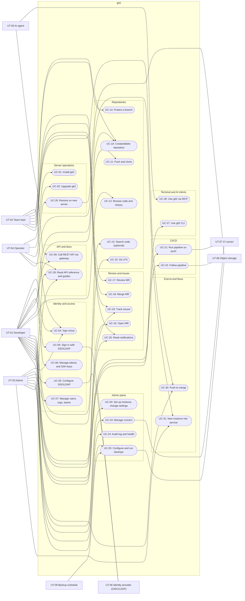

**Notes:**

- **Actors.** UT-01 and UT-02 use the Dash plane, the CLI (UC-27) or Git (UC-11); UT-03 the Admin plane; UT-04 the host or cluster; UT-05 only git2-mcp and the REST API. UT-06–UT-09 support; UT-09 starts scheduled backups.
- **Coverage (task: use cases).** T-01: UC-09. T-02: UC-04. T-03: UC-07, UC-08. T-04: UC-05, UC-06. T-05: UC-10, UC-11. T-06: UC-12, UC-13 (optional, WBS-6.2). T-07: UC-14, UC-15. T-08: UC-16–UC-18. T-09: UC-19, UC-20. T-10: UC-21–UC-23. T-11: UC-03, UC-23, UC-24. T-12: UC-25, UC-26. T-13: UC-01, UC-02. T-14: UC-27. T-15: UC-28. T-16: UC-29. T-17: UC-30, UC-31. T-18 is a process task with no use case.
- **Relationships** («include», «extend») are shown only in 3.3.2–3.3.13.

#### 3.3.2 Functionality-Specific Use Case Diagram: Identity and Access Management

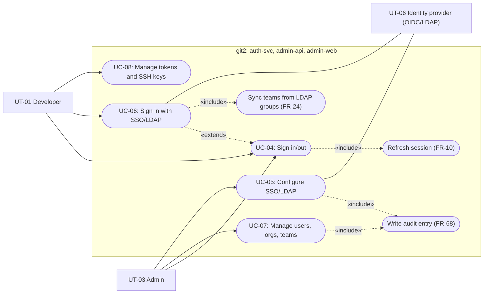

**Functionality covered:** T-02, T-03, T-04 / FR-08–FR-24 / UC-04–UC-08  
**Diagram notes:**

- UC-06 extends UC-04: SSO/LDAP replaces the password step when a provider is configured. UC-08 is self-service.

#### 3.3.3 Functionality-Specific Use Case Diagram: Service Foundation, API Gateway and Documentation

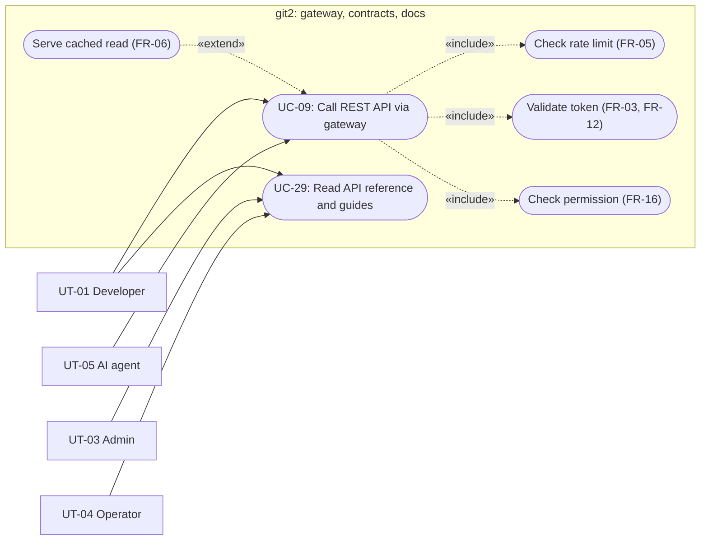

**Functionality covered:** T-01, T-16 / FR-01–FR-07, FR-99, FR-91–FR-94 / UC-09, UC-29  
**Diagram notes:**

- Cache extends only frequently read data. The CLI and git2-mcp also use UC-09.
- The event outbox (FR-04) is part of UC-11 and UC-21.

#### 3.3.4 Functionality-Specific Use Case Diagram: Repository Hosting, Code Browsing, Branch Protection and Git LFS

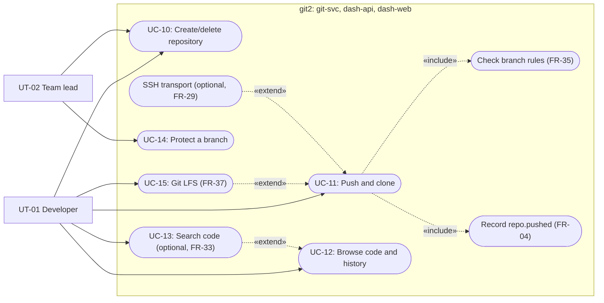

**Functionality covered:** T-05, T-06, T-07 / FR-25–FR-37 / UC-10–UC-15  
**Diagram notes:**

- UT-01 starts UC-10 to UC-13 and UC-15; UT-02 starts UC-10 and UC-14.
- Every push (UC-11) «include»s the branch-rule check and one `repo.pushed` record.
- LFS (UC-15) and optional SSH «extend» UC-11; optional search (UC-13) «extend»s UC-12.

#### 3.3.5 Functionality-Specific Use Case Diagram: Merge Requests and Code Review

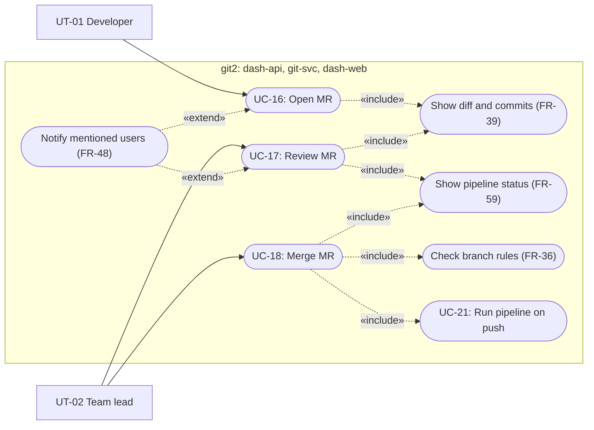

**Functionality covered:** T-08 (and FR-36 of T-07, FR-59 of T-10) / FR-36, FR-38–FR-44, FR-59 / UC-16–UC-18  
**Diagram notes:**

- A merge updates the target branch, so it includes UC-21.
- A Write-role developer may also do UC-17 and UC-18 if branch rules allow.

#### 3.3.6 Functionality-Specific Use Case Diagram: Issue Tracking and Notifications

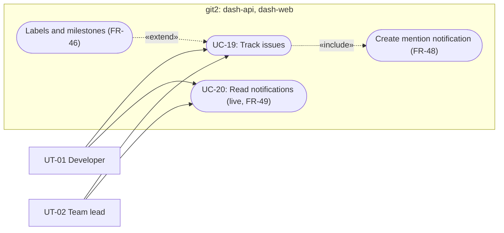

**Functionality covered:** T-09 / FR-45–FR-49 / UC-19, UC-20  
**Diagram notes:**

- Labels and milestones need the Write role. UC-20 reads notifications from UC-16, UC-17, UC-19.

#### 3.3.7 Functionality-Specific Use Case Diagram: CI/CD Pipelines

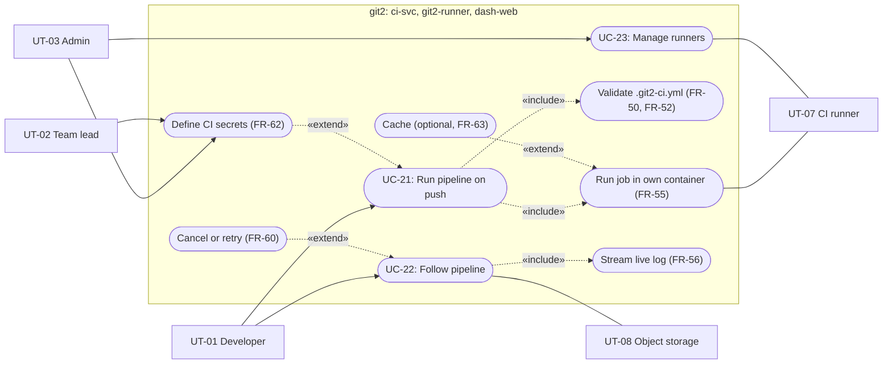

**Functionality covered:** T-10 (and FR-66, FR-67 of T-11, FR-04 of T-01) / FR-04, FR-50–FR-63, FR-66, FR-67 / UC-21–UC-23  
**Diagram notes:**

- Secrets and cache extend only when defined; UT-02 sets repository secrets, UT-03 instance secrets. Artifacts go to object storage (FR-57).
- UC-23 (Admin plane) is shown because no job runs without a runner.

#### 3.3.8 Functionality-Specific Use Case Diagram: Admin Plane

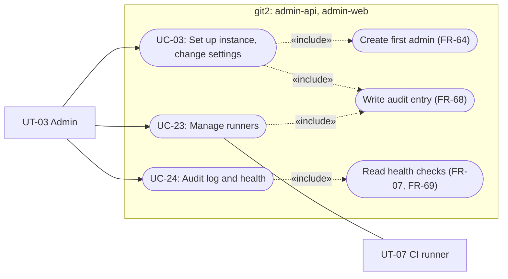

**Functionality covered:** T-11 / FR-07, FR-64–FR-69 / UC-03, UC-23, UC-24  
**Diagram notes:**

- First-admin creation runs only on a fresh instance; later visits change settings (FR-65). UC-05, UC-07 are in 3.3.2.

#### 3.3.9 Functionality-Specific Use Case Diagram: Backup and Restore

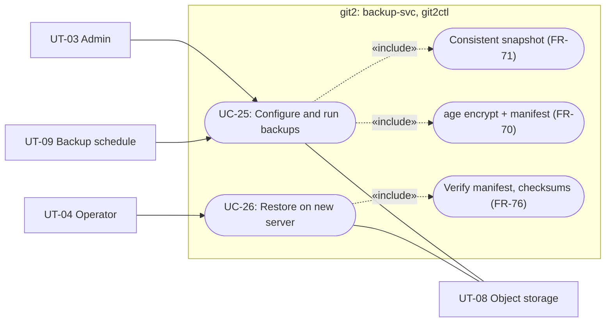

**Functionality covered:** T-12 / FR-70–FR-76, FR-100 / UC-25, UC-26  
**Diagram notes:**

- Admin sets schedule, retention, on-demand runs; operator sets destination and public key in `git2.yaml`.
- Restore verifies before writing and runs from the host (no web UI yet).

#### 3.3.10 Functionality-Specific Use Case Diagram: Packaging and Deployment

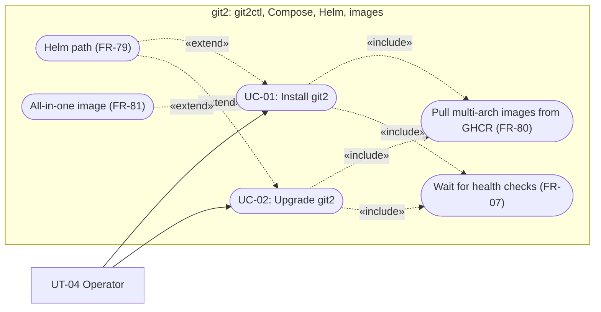

**Functionality covered:** T-13 / FR-77–FR-82 / UC-01, UC-02  
**Diagram notes:**

- Helm extends both; all-in-one extends install only. The reference instance (FR-82) uses the same flows.

#### 3.3.11 Functionality-Specific Use Case Diagram: git2 CLI

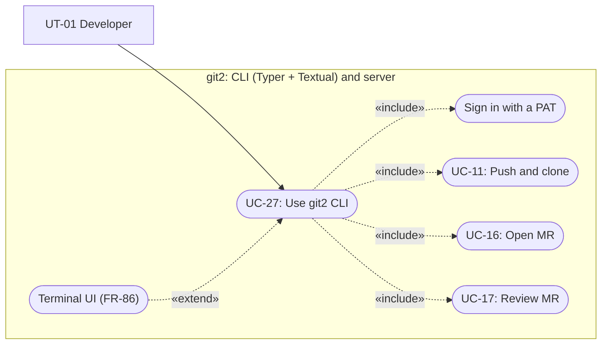

**Functionality covered:** T-14 / FR-83–FR-86 / UC-27  
**Diagram notes:**

- UT-01 starts UC-27, which «include»s PAT sign-in, push and clone (UC-11), and opening and reviewing MRs (UC-16, UC-17).
- The terminal UI «extend»s UC-27 when `git2` runs without arguments.

#### 3.3.12 Functionality-Specific Use Case Diagram: AI Agent Integration (MCP)

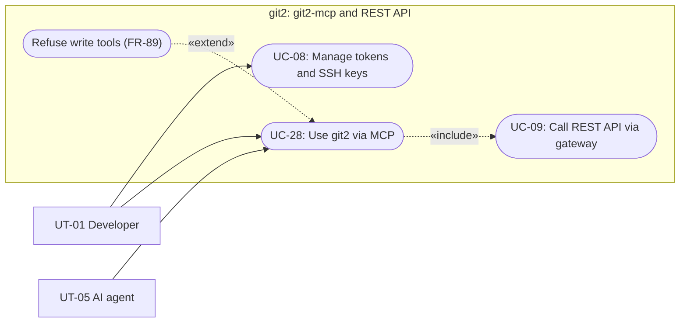

**Functionality covered:** T-15 / FR-87–FR-90 / UC-28  
**Diagram notes:**

- Each tool call uses the scoped PAT from UC-08 through UC-09, so normal permissions apply. Read-only refusal makes no API call.

#### 3.3.13 Functionality-Specific Use Case Diagram: End-to-End Integration Flows

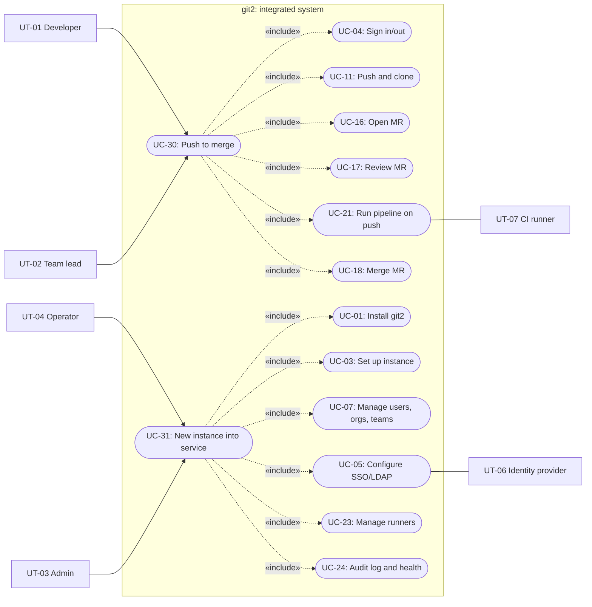

**Functionality covered:** T-17 / FR-95, FR-96 / UC-30, UC-31  
**Diagram notes:**

- UC-30 is the D-02 developer flow; UC-31 is the D-03 administrator flow.
- Both run in the Playwright E2E suite (WBS-17.2) and the Friday integration check (WBS-17.1).

### 3.4 Use Cases

#### 3.4.1 Use Case Coverage Matrix

| Project Plan task ID | Functional requirement ID(s) | Use case ID(s) | Scenario ID(s) |
|---|---|---|---|
| T-01 | FR-01–FR-07, FR-99 | UC-09, UC-11, UC-21, UC-24 | SC-13, SC-04, SC-01 |
| T-02 | FR-03, FR-08–FR-13 | UC-04 | SC-03, SC-01 |
| T-03 | FR-14–FR-20 | UC-07, UC-08 | SC-02, SC-03, SC-09 |
| T-04 | FR-21–FR-24 | UC-05, UC-06 | SC-02, SC-03 |
| T-05 | FR-25–FR-29 | UC-10, UC-11 | SC-03, SC-13 |
| T-06 | FR-30–FR-33, FR-97, FR-98 | UC-12, UC-13 | SC-03, SC-09 |
| T-07 | FR-34–FR-37 | UC-14, UC-15, UC-18 | SC-06, SC-05 |
| T-08 | FR-36, FR-38–FR-44, FR-59 | UC-16, UC-17, UC-18 | SC-05 |
| T-09 | FR-45–FR-49 | UC-19, UC-20 | SC-07 |
| T-10 | FR-50–FR-63 | UC-21, UC-22, UC-23 | SC-04, SC-05, SC-09 |
| T-11 | FR-07, FR-64–FR-69 | UC-03, UC-23, UC-24 | SC-01, SC-02, SC-11 |
| T-12 | FR-70–FR-76, FR-100 | UC-25, UC-26 | SC-10 |
| T-13 | FR-77–FR-82 | UC-01, UC-02 | SC-01, SC-11, SC-12 |
| T-14 | FR-83–FR-86 | UC-27 | SC-08 |
| T-15 | FR-87–FR-90 | UC-28 | SC-09 |
| T-16 | FR-91–FR-94 | UC-29 | SC-01, SC-12, SC-13 |
| T-17 | FR-82, FR-95, FR-96 | UC-30, UC-31 | SC-05, SC-02 |
| T-18 | (project management and course reports; no system behavior) | (none) | (none) |

Every development task of Project Plan §1.3 is covered. Optional items FR-29, FR-33 and FR-63 appear as alternative flows of UC-11 and UC-21, and as UC-13.

#### 3.4.2 UC-01: Install git2

| Field | Description |
|---|---|
| **Use case ID** | UC-01 |
| **Use case name** | Install git2 |
| **Goal / Purpose** | The operator brings up git2 on the organization's own server with one command. |
| **Actor(s)** | UT-04 (Platform operator) |
| **Related Project Plan task(s)** | T-13, T-16 |
| **Related functional requirement(s)** | FR-77, FR-79, FR-80, FR-81, FR-92 |

**Pre-condition(s):**
- Linux host (amd64/arm64) with Docker and Compose; DNS name and TLS certificate.
- Registry reachable; release images published (FR-80).

**Main success flow:**

1. **Operator:** Runs `git2ctl install <host>` (FR-77), following the install guide (FR-92).
2. **System:** Checks Docker, Compose, free ports 80/443, architecture.
3. **System:** Writes `git2.yaml` with host name and new secrets.
4. **System:** Pulls images for the architecture.
5. **System:** Starts services, PostgreSQL, Redis on named volumes; runs migrations.
6. **System:** Waits for health checks (FR-07); prints the HTTPS address.
7. **Operator:** Opens the address; wizard opens (UC-03).

**Alternative flows:**

- **A1: Kubernetes (from step 1):** Helm chart with a values file, one Deployment per service (FR-79); step 6 when pods are healthy.
- **A2: All-in-one image (from step 5):** One container runs everything (FR-81); step 6.
- **A3: Already installed (from step 2):** Refuses, suggests `git2ctl upgrade` (UC-02); no change.

**Exception / error flows (if applicable):**

- **E1: Prerequisite missing (step 2):** Names it (e.g. "port 443 in use"); nothing written.
- **E2: Image pull fails (step 4):** Registry error shown; nothing started.
- **E3: Service unhealthy (step 6):** Names service and logs; containers stay up.

**Post-condition(s):**
- HTTPS reachable, healthy, data on persistent volumes, `git2.yaml` on host.
- No user yet; wizard waits.
- Under 10 minutes on a clean host (NFR-15).

#### 3.4.3 UC-02: Upgrade git2

| Field | Description |
|---|---|
| **Use case ID** | UC-02 |
| **Use case name** | Upgrade git2 |
| **Goal / Purpose** | The operator moves a running instance to a newer release without data loss. |
| **Actor(s)** | UT-04 (Platform operator) |
| **Related Project Plan task(s)** | T-13 |
| **Related functional requirement(s)** | FR-78, FR-80, FR-82 |

**Pre-condition(s):**
- Instance installed with `git2ctl` (Helm for A2); newer release published.
- Snapshot taken first (recommended, UC-25).

**Main success flow:**

1. **Operator:** Runs `git2ctl upgrade`, optionally with a target version.
2. **System:** Shows both versions, asks to confirm.
3. **Operator:** Confirms.
4. **System:** Pulls images, stops services, migrates, restarts; keeps volumes and `git2.yaml`.
5. **System:** Waits for health checks; reports the new version.

**Alternative flows:**

- **A1: Already latest (from step 2):** "No upgrade available"; no change.
- **A2: Kubernetes (from step 1):** `helm upgrade` replaces Deployments and migrates; step 5.
- **A3: Live reference instance (whole flow):** Team upgrades the public reference instance after each release tag (FR-82).

**Exception / error flows (if applicable):**

- **E1: Migration fails (step 4):** Stops, names it, new version not started; restore via UC-26.
- **E2: Service unhealthy (step 5):** Names service and logs; data unchanged.

**Post-condition(s):**
- Target release running; health checks pass.
- Repositories, users, teams, settings, pipeline history unchanged.

#### 3.4.4 UC-03: Set Up the Instance and Change Settings

| Field | Description |
|---|---|
| **Use case ID** | UC-03 |
| **Use case name** | Set up the instance and change settings |
| **Goal / Purpose** | The administrator creates the first admin account and later changes settings without editing server files. |
| **Actor(s)** | UT-03 (Instance administrator) |
| **Related Project Plan task(s)** | T-11, T-03 |
| **Related functional requirement(s)** | FR-64, FR-65, FR-20, FR-68 |

**Pre-condition(s):**
- Instance installed and healthy (UC-01).
- Main flow: no administrator yet. A1: administrator signed in.

**Main success flow:**

1. **Administrator:** Opens the HTTPS address.
2. **System:** No administrator: shows the setup wizard.
3. **Administrator:** Enters email, username, password, instance name, external URL.
4. **System:** Validates, creates account, stores settings, audits.
5. **System:** Closes wizard permanently, signs in, opens Admin.

**Alternative flows:**

- **A1: Change settings later (from step 1):** Edit in **Instance settings**; validated, applied, old and new value audited (FR-65, FR-68).
- **A2: Wizard opened after setup (from step 2):** Sign-in page shown; wizard not reusable (FR-64).

**Exception / error flows (if applicable):**

- **E1: Invalid input (step 4):** Fields marked, nothing created; back to step 3.
- **E2: Database unavailable (step 4):** 5xx "try again"; nothing created.

**Post-condition(s):**
- Exactly one administrator; wizard closed; settings audited.
- No public sign-up (FR-20); accounts only via UC-07 or UC-06.

#### 3.4.5 UC-04: Sign In and Sign Out

| Field | Description |
|---|---|
| **Use case ID** | UC-04 |
| **Use case name** | Sign in and sign out |
| **Goal / Purpose** | A user signs in once and works in Dash and Admin with a secure, revocable session. |
| **Actor(s)** | UT-01 (Software developer); UT-02 (Team lead / reviewer); UT-03 (Instance administrator) |
| **Related Project Plan task(s)** | T-02, T-01 |
| **Related functional requirement(s)** | FR-03, FR-08, FR-09, FR-10, FR-11, FR-12, FR-13 |

**Pre-condition(s):**
- Active account (SSO identity for A1); HTTPS reachable.

**Main success flow:**

1. **User:** Opens Dash or Admin.
2. **System:** No session: shared sign-in page (FR-08).
3. **User:** Enters email and password.
4. **System:** Verifies, creates Redis session, returns access and refresh tokens in headers (FR-09).
5. **System:** Opens the app; other plane needs no new sign-in; Admin only for administrators.
6. **System:** Rotates the pair before expiry; old refresh token dies (FR-10).
7. **User:** Selects **Sign out**.
8. **System:** Revokes both tokens (FR-11).

**Alternative flows:**

- **A1: Single sign-on (from step 3):** Continues in UC-06 (extends this), returns at step 5.
- **A2: Non-administrator opens Admin (from step 5):** 403 with a message; Dash stays available.
- **A3: Reused refresh token (from step 6):** Whole session ended (FR-10); back to step 2.

**Exception / error flows (if applicable):**

- **E1: Wrong credentials (step 4):** 401 "invalid credentials", same for unknown email (FR-13).
- **E2: Too many attempts (step 4):** 429 with `Retry-After` (FR-13).
- **E3: Account disabled (step 4):** 403 "account is disabled" (FR-13, FR-14).
- **E4: PostgreSQL or Redis down (step 4 or 6):** 503 "try again"; client keeps tokens (NFR-22).

**Post-condition(s):**
- Signed in: one Redis session; token pair valid in both planes.
- Signed out: every service refuses both tokens (FR-12).

#### 3.4.6 UC-05: Configure SSO and LDAP

| Field | Description |
|---|---|
| **Use case ID** | UC-05 |
| **Use case name** | Configure SSO and LDAP |
| **Goal / Purpose** | The administrator connects the OIDC provider and LDAP directory so staff use existing accounts and teams follow the directory. |
| **Actor(s)** | UT-03 (Instance administrator, primary); UT-06 (Identity provider, supporting) |
| **Related Project Plan task(s)** | T-04 |
| **Related functional requirement(s)** | FR-21, FR-23, FR-24, FR-68 |

**Pre-condition(s):**
- Administrator signed in; teams exist (UC-07).
- OIDC client registered with git2's redirect URL; LDAP reachable with bind account.

**Main success flow:**

1. **Administrator:** In **Authentication**, adds OIDC: name, issuer URL, client ID and secret.
2. **System:** Reads discovery document, validates, stores secret as instance secret, audits (FR-21).
3. **Administrator:** Adds LDAP: URL, bind account and password, user and group search bases.
4. **System:** Tests bind and sample search (FR-23).
5. **Administrator:** Maps LDAP groups to git2 teams and saves.
6. **System:** Stores and audits; sign-in page offers both (FR-24).

**Alternative flows:**

- **A1: One method only (from step 1 or 3):** Other part skipped; step 6.
- **A2: Disable a provider (from step 1):** Removed from sign-in, audited; its accounts remain but cannot use it.

**Exception / error flows (if applicable):**

- **E1: Wrong issuer or unreachable provider (step 2):** Error shown; nothing saved.
- **E2: LDAP bind or search fails (step 4):** Directory error shown; nothing saved.

**Post-condition(s):**
- Providers on sign-in page; mapping stored; changes audited.

#### 3.4.7 UC-06: Sign In with SSO or LDAP

| Field | Description |
|---|---|
| **Use case ID** | UC-06 |
| **Use case name** | Sign in with SSO or LDAP |
| **Goal / Purpose** | A user signs in with an organization account; git2 creates or links the account and syncs teams. |
| **Actor(s)** | UT-01 (Software developer, any user, primary); UT-06 (Identity provider, supporting) |
| **Related Project Plan task(s)** | T-04 |
| **Related functional requirement(s)** | FR-22, FR-23, FR-24, FR-20 |

**Pre-condition(s):**
- Provider configured (UC-05); user exists there.

**Main success flow:**

1. **User:** Selects **Sign in with** the OIDC provider.
2. **System:** Redirects to the provider.
3. **User:** Authenticates at the provider.
4. **Identity provider:** Redirects back with an authorization code.
5. **System:** Exchanges code, validates ID token, finds linked account.
6. **System:** Session and tokens as in UC-04 step 4; opens the app.

**Alternative flows:**

- **A1: First OIDC sign-in (from step 5):** Links to the account with the same verified email, else creates one from claims (FR-22, FR-20); step 6.
- **A2: LDAP sign-in (from step 1):** (1) User enters LDAP credentials. (2) System binds, reads groups. (3) Creates account on first sign-in; syncs mapped teams every time (FR-23, FR-24). Step 6.

**Exception / error flows (if applicable):**

- **E1: Fails or cancelled at provider (step 3 or A2.2):** Back to sign-in with a message.
- **E2: Provider or directory unreachable (step 5 or A2.2):** 503 "sign-in provider unavailable"; local sign-in (UC-04) still works.
- **E3: git2 account disabled (step 5):** Refused with "account is disabled" (FR-14).

**Post-condition(s):**
- Signed in; account linked to the external identity.
- After LDAP sign-in, teams match current groups.

#### 3.4.8 UC-07: Manage Users, Organizations and Teams

| Field | Description |
|---|---|
| **Use case ID** | UC-07 |
| **Use case name** | Manage users, organizations and teams |
| **Goal / Purpose** | The administrator maintains accounts, organizations, teams and roles so each person reaches exactly the repositories they need. |
| **Actor(s)** | UT-03 (Instance administrator) |
| **Related Project Plan task(s)** | T-03 |
| **Related functional requirement(s)** | FR-14, FR-15, FR-16, FR-20, FR-68 |

**Pre-condition(s):**
- Administrator signed in to Admin.

**Main success flow:**

1. **Administrator:** Opens **Users**.
2. **System:** Lists users: status, sign-in method, admin flag.
3. **Administrator:** **New user**: email, username, initial password.
4. **System:** Checks uniqueness (case-insensitive), creates, audits.
5. **Administrator:** Creates organization and team; adds users.
6. **Administrator:** Grants the team Read, Write or Maintain on the organization or one repository.
7. **System:** Stores, audits steps 5–6, enforces on every API call and Git operation (FR-16).

**Alternative flows:**

- **A1: Disable or re-enable (from step 2):** Disable blocks sign-in, refresh and PATs, audited (FR-14); re-enable does not restore tokens.
- **A2: Edit a user (from step 2):** Email, username or admin flag; uniqueness checked; audited.
- **A3: Change membership or roles (from step 5 or 6):** Applies on next request; audited.

**Exception / error flows (if applicable):**

- **E1: Duplicate email or username (step 4):** 409 "email already registered" or "username already taken"; nothing created.
- **E2: Caller not administrator (any step):** admin-api returns 403 (FR-16).

**Post-condition(s):**
- Stored; permissions apply at once; changes audited.
- No public sign-up (FR-20).

#### 3.4.9 UC-08: Manage Personal Access Tokens and SSH Keys

| Field | Description |
|---|---|
| **Use case ID** | UC-08 |
| **Use case name** | Manage personal access tokens and SSH keys |
| **Goal / Purpose** | A user gives Git clients, scripts, the git2 CLI and AI agents limited, revocable access. |
| **Actor(s)** | UT-01 (Software developer, any user) |
| **Related Project Plan task(s)** | T-03 |
| **Related functional requirement(s)** | FR-17, FR-18, FR-19 |

**Pre-condition(s):**
- User signed in (UC-04 or UC-06).

**Main success flow:**

1. **User:** **Access tokens** > **New token**.
2. **User:** Names it, picks scopes (e.g. read-only).
3. **System:** Stores only the hash; shows the value once (FR-17).
4. **User:** Puts it in the Git credential helper, git2 CLI or git2-mcp config.
5. **User:** Adds a public key with a title in **SSH keys**.
6. **System:** Validates, stores, shows fingerprint (FR-19).

**Alternative flows:**

- **A1: Revoke a token (from step 1):** Invalid at once; next use gets 401 (FR-18).
- **A2: Remove an SSH key (from step 5):** Deleted; the optional SSH transport (FR-29) rejects it.

**Exception / error flows (if applicable):**

- **E1: Invalid or duplicate SSH key (step 6):** Rejected with reason.
- **E2: Token used beyond scope (after step 4):** Write with a read-only token gets 403 (FR-16, FR-17).

**Post-condition(s):**
- Token listed by name and scopes; value never shown again.
- Key listed with fingerprint; revoked tokens and removed keys stop working.

#### 3.4.10 UC-09: Call the REST API Through the Gateway

| Field | Description |
|---|---|
| **Use case ID** | UC-09 |
| **Use case name** | Call the REST API through the gateway |
| **Goal / Purpose** | A program acting for a user reads or changes git2 data through the documented REST API with predictable errors. |
| **Actor(s)** | UT-01 (Software developer: script author, git2 CLI); UT-05 (AI coding agent, through git2-mcp) |
| **Related Project Plan task(s)** | T-01 |
| **Related functional requirement(s)** | FR-01, FR-02, FR-03, FR-05, FR-06, FR-07, FR-16, FR-99 |

**Pre-condition(s):**
- Client has a PAT or access token (UC-08, UC-04); endpoint from the OpenAPI spec (FR-01, FR-91).

**Main success flow:**

1. **Client:** Sends HTTPS request with token to `/api/...`.
2. **System (gateway):** Terminates TLS, checks rate budget (FR-05).
3. **System (gateway):** Validates token, strips client identity headers, forwards with `Authorization` unchanged to the owning service (FR-02, FR-03, FR-99).
4. **System (service):** Re-verifies token, checks role (FR-16).
5. **System (service):** Acts; response matches OpenAPI (FR-01).
6. **System (gateway):** Returns it.

**Alternative flows:**

- **A1: Cached read (from step 5):** Served from Redis, no PostgreSQL query (FR-06); step 6.
- **A2: Health check (from step 1):** Service, PostgreSQL and Redis status, no token needed (FR-07).

**Exception / error flows (if applicable):**

- **E1: Missing or invalid token (step 3):** Gateway 401 with `{"error": "…"}`; no service reached (FR-03).
- **E2: Rate limit exceeded (step 2):** 429 with `Retry-After` (FR-05).
- **E3: Not permitted (step 4):** 403 (FR-16).
- **E4: Invalid body (step 5):** 400 for unknown fields, trailing data or body over 64 KiB.
- **E5: Database or Redis fault (step 4 or 5):** 5xx, never 401; client keeps its token (NFR-22).
- **E6: Service unreachable or slow (step 3):** 503 if unreachable, 504 on timeout.

**Post-condition(s):**
- Every request answered per OpenAPI or refused with a documented status.
- No request reaches a service without a valid token, except FR-03 exemptions.

#### 3.4.11 UC-10: Create or Delete a Repository

| Field | Description |
|---|---|
| **Use case ID** | UC-10 |
| **Use case name** | Create or delete a repository |
| **Goal / Purpose** | Repositories without asking IT. |
| **Actor(s)** | UT-01 (Software developer); UT-02 (Team lead / reviewer) |
| **Related Project Plan task(s)** | T-05 |
| **Related functional requirement(s)** | FR-25, FR-26, FR-16 |

**Pre-condition(s):**
- Signed in; Maintain to create in an organization or to delete.

**Main success flow:**

1. **Developer:** Submits **New repository** (UI-G1).
2. **System:** Checks the name (FR-25), creates the repository, shows the clone URL.

**Alternative flows:**

- **A1: Delete (from step 1):** Name typed; unlisted, refused over Git, name free at once (FR-26).

**Exception / error flows (if applicable):**

- **E1: Name taken or invalid (step 2):** Rule shown; nothing created.
- **E2: No permission (step 2 or A1):** 403 (FR-16).

**Post-condition(s):**
- Clonable and pushable (UC-11); after A1, gone.

#### 3.4.12 UC-11: Push and Clone with Git

| Field | Description |
|---|---|
| **Use case ID** | UC-11 |
| **Use case name** | Push and clone with Git |
| **Goal / Purpose** | Move code with standard `git`. |
| **Actor(s)** | UT-01 (Software developer) |
| **Related Project Plan task(s)** | T-05, T-01, T-03, T-07 |
| **Related functional requirement(s)** | FR-27, FR-28, FR-29, FR-04, FR-35, FR-19 |

**Pre-condition(s):**
- Repository (UC-10); PAT (UC-08); Read to clone, Write to push.

**Main success flow:**

1. **Developer:** Clones over HTTPS.
2. **System:** Checks Read; serves it (FR-27, FR-28).
3. **Developer:** Pushes.
4. **System:** Checks Write and branch rules; updates refs; records `repo.pushed` (FR-35, FR-04).

**Alternative flows:**

- **A1: SSH, optional (from step 1):** Registered key (FR-19, FR-29).
- **A2: LFS files (from step 3):** UC-15 first.

**Exception / error flows (if applicable):**

- **E1: Bad token or role (step 2 or 4):** Refused (FR-28).
- **E2: Protected branch (step 4):** Refused; refs unchanged (FR-35).
- **E3: Crash after the ref update (step 4):** No event or pipeline (FR-04).

**Post-condition(s):**
- Clone, or refs updated with one event (except E3).

#### 3.4.13 UC-12: Browse Code and History

| Field | Description |
|---|---|
| **Use case ID** | UC-12 |
| **Use case name** | Browse code and history |
| **Goal / Purpose** | A developer reads files and history of any branch or tag in the browser without cloning. |
| **Actor(s)** | UT-01 (Software developer; also UT-02) |
| **Related Project Plan task(s)** | T-06 |
| **Related functional requirement(s)** | FR-30, FR-31, FR-32, FR-97, FR-98 |

**Pre-condition(s):**
- Signed in with Read role.

**Main success flow:**

1. **Developer:** Picks the repository in Dash (FR-97).
2. **System:** Default branch tree and latest commit.
3. **Developer:** Picks a branch or tag.
4. **System:** Its tree (FR-32).
5. **Developer:** Opens a file.
6. **System:** Syntax highlighting and line numbers (FR-30).
7. **Developer:** Opens history, picks a commit.
8. **System:** Message, author, date, per-file diffs (FR-31).

**Alternative flows:**

- **A1: Empty repository (from step 2):** Clone URL and first-push instructions (FR-98).
- **A2: Search (from step 3):** Via UC-13 (optional); step 6 at the line.
- **A3: Binary or large file (from step 6):** Binary, over 1 MiB or LFS: size and download link (FR-30).
- **A4: Link to a line (from step 6):** Line number gives a shareable URL that highlights it (FR-30).
- **A5: File or directory history (from step 7):** Only commits touching it (FR-31).

**Exception / error flows (if applicable):**

- **E1: Missing branch, tag or path (step 4 or 6):** "not found" with link to default branch.
- **E2: No Read role (step 1):** Not listed; URL shows "not found" (FR-16, FR-97).
- **E3: Large commit (step 8):** Over 300 files: first 300, marked truncated (FR-31).

**Post-condition(s):**
- Read-only; nothing changed.

#### 3.4.14 UC-13: Search Code (Optional)

| Field | Description |
|---|---|
| **Use case ID** | UC-13 |
| **Use case name** | Search code |
| **Goal / Purpose** | A developer or AI agent finds text in a repository's default branch. |
| **Actor(s)** | UT-01 (Software developer); UT-05 (AI coding agent, through `search_code`) |
| **Related Project Plan task(s)** | T-06 (optional activity WBS-6.2) |
| **Related functional requirement(s)** | FR-33, FR-88 |

**Pre-condition(s):**
- WBS-6.2 delivered.
- Read role; default branch has commits.

**Main success flow:**

1. **Developer:** Types a query.
2. **System:** Searches the default branch.
3. **System:** Lists matching files and lines, linked to the file view.
4. **Developer:** Opens a result; UC-12 view at the line.

**Alternative flows:**

- **A1: No matches (from step 3):** "no results"; back to step 1.
- **A2: AI agent (from step 1):** `search_code` via git2-mcp, same endpoint (FR-88).

**Exception / error flows (if applicable):**

- **E1: Feature not delivered (step 1):** No search box; `search_code` returns "not available".

**Post-condition(s):**
- Nothing changed.

#### 3.4.15 UC-14: Protect a Branch

| Field | Description |
|---|---|
| **Use case ID** | UC-14 |
| **Use case name** | Protect a branch |
| **Goal / Purpose** | `main` changes only through allowed, reviewed merges. |
| **Actor(s)** | UT-02 (Team lead / reviewer) |
| **Related Project Plan task(s)** | T-07 |
| **Related functional requirement(s)** | FR-34, FR-35, FR-36 |

**Pre-condition(s):**
- Maintain role; branch exists.

**Main success flow:**

1. **Team lead:** Sets push, merge and approval rules (UI-G2).
2. **System:** Saves; enforces them on every push (UC-11) and merge (UC-18); never allows force-push or deletion (FR-34–FR-36).

**Alternative flows:**

- **A1: Change or remove (from step 1):** Applies from the next push or merge.

**Exception / error flows (if applicable):**

- **E1: Not a maintainer, or no such branch (step 2):** Nothing saved.

**Post-condition(s):**
- Rules enforced on every push and merge.

#### 3.4.16 UC-15: Store Large Files with Git LFS

| Field | Description |
|---|---|
| **Use case ID** | UC-15 |
| **Use case name** | Store large files with Git LFS |
| **Goal / Purpose** | Large files without bloating history. |
| **Actor(s)** | UT-01 (Software developer) |
| **Related Project Plan task(s)** | T-07 |
| **Related functional requirement(s)** | FR-37, FR-28, FR-70 |

**Pre-condition(s):**
- `git-lfs`; PAT; Write to upload, Read to download.

**Main success flow:**

1. **Developer:** Tracks files with `git lfs track`; pushes.
2. **System:** Checks Write; stores missing objects after size and hash checks; accepts the push (UC-11).
3. **Developer:** A colleague clones; objects download after a Read check.

**Alternative flows:**

- **A1: Object already stored (from step 2):** Skipped.

**Exception / error flows (if applicable):**

- **E1: No Write role (step 2):** 403; push fails.
- **E2: Hash or size mismatch (step 2):** Object refused.

**Post-condition(s):**
- In the next snapshot (FR-70); no locking.

#### 3.4.17 UC-16: Open a Merge Request

| Field | Description |
|---|---|
| **Use case ID** | UC-16 |
| **Use case name** | Open a merge request |
| **Goal / Purpose** | Request review of a branch before merging. |
| **Actor(s)** | UT-01: Software developer |
| **Related Project Plan task(s)** | T-08 |
| **Related functional requirement(s)** | FR-38, FR-39, FR-44, FR-48, FR-59 |

**Pre-condition(s):**
- Source branch pushed (UC-11); developer has Write.

**Main success flow:**

1. **Developer:** Selects **New merge request**.
2. **Developer:** Picks source and target branches.
3. **System:** Previews commits and diff (FR-39).
4. **Developer:** Enters title, description, optional `@username` mentions; submits.
5. **System:** Creates open merge request `!n`, notifies mentions (FR-48), shows source pipeline status (FR-59).

**Alternative flows:**

- **A1: New commits (from step 5):** Commits, diff, pipeline update (FR-39); inline comments on changed lines become outdated (FR-40).
- **A2: Close and reopen (from step 5):** Closed merge requests move to the closed list (FR-44); author can reopen (FR-38).

**Exception / error flows (if applicable):**

- **E1: Nothing to merge (at step 3):** No diff; nothing created.
- **E2: Same branch twice (at step 2):** Selection refused.
- **E3: No Write role (at step 5):** 403 (FR-16).

**Post-condition(s):**
- Listed under **Open** (FR-44) with diff and pipeline status.

#### 3.4.18 UC-17: Review a Merge Request

| Field | Description |
|---|---|
| **Use case ID** | UC-17 |
| **Use case name** | Review a merge request |
| **Goal / Purpose** | Check a change line by line, discuss and approve it. |
| **Actor(s)** | UT-02: Team lead / reviewer (also UT-01 with Write) |
| **Related Project Plan task(s)** | T-08, T-10 |
| **Related functional requirement(s)** | FR-39, FR-40, FR-41, FR-48, FR-59 |

**Pre-condition(s):**
- Merge request open (UC-16); Read to comment, Write to approve.

**Main success flow:**

1. **Reviewer:** Opens the merge request.
2. **System:** Shows description, commits, diff, approvals, pipeline (FR-39, FR-59).
3. **Reviewer:** Comments on a diff line.
4. **System:** Shows comment on the line; notifies mentions (FR-40, FR-48).
5. **Author (UT-01):** Pushes a fix.
6. **System:** Updates diff and pipeline.
7. **Reviewer:** Selects **Approve**.
8. **System:** Lists reviewer as approver (FR-41).

**Alternative flows:**

- **A1: General comment or reply (from step 3):** Saved; continues at step 4.
- **A2: Withdraw approval (from step 8):** Reviewer removed from approvers.

**Exception / error flows (if applicable):**

- **E1: Read role only (at step 8):** 403; commenting still allowed.

**Post-condition(s):**
- Comments and approvals visible to all Read users.

#### 3.4.19 UC-18: Merge a Merge Request

| Field | Description |
|---|---|
| **Use case ID** | UC-18 |
| **Use case name** | Merge a merge request |
| **Goal / Purpose** | Merge a reviewed change with the agreed strategy. |
| **Actor(s)** | UT-02: Team lead / reviewer (or UT-01 where branch rules allow) |
| **Related Project Plan task(s)** | T-08, T-07, T-10 |
| **Related functional requirement(s)** | FR-42, FR-43, FR-36, FR-59, FR-51 |

**Pre-condition(s):**
- Merge request open; Write, or the protected target's rules met.

**Main success flow:**

1. **System:** Shows mergeability or why not (FR-43), a failed-pipeline warning (FR-59), approvals.
2. **Team lead:** Picks merge commit, squash or fast-forward (FR-42).
3. **System:** Re-checks rules (FR-36), merges, records the update as a push; a pipeline starts (UC-21, FR-51).

**Alternative flows:**

- **A1: Fast-forward impossible (from step 2):** Another strategy.

**Exception / error flows (if applicable):**

- **E1: Conflicts (step 1 or 3):** Files listed; target unchanged (FR-43); author fixes (UC-16 A1).
- **E2: Rules not met (step 3):** Refused with reason (FR-36).
- **E3: Target moved (step 3):** Merged again if clean, else E1.

**Post-condition(s):**
- Target has the change; merge request merged.

#### 3.4.20 UC-19: Track Work with Issues

| Field | Description |
|---|---|
| **Use case ID** | UC-19 |
| **Use case name** | Track work with issues |
| **Goal / Purpose** | Plan work next to code with labels, milestones, assignees, mentions. |
| **Actor(s)** | UT-02: Team lead / reviewer; UT-01: Software developer |
| **Related Project Plan task(s)** | T-09 |
| **Related functional requirement(s)** | FR-45, FR-46, FR-47, FR-48 |

**Pre-condition(s):**
- Signed in; Read to create and comment, Write for labels, milestones, assignees.

**Main success flow:**

1. **Team lead:** Opens **Issues**.
2. **Team lead:** Creates labels `bug`, `feature`, milestone `Release 2.3` (FR-46).
3. **Team lead:** Creates an issue with labels, milestone, assignee.
4. **System:** Lists it as open (FR-45).
5. **Team lead:** Comments mentioning `@deniz`.
6. **System:** Notifies Deniz (FR-48, UC-20).
7. **Developer:** Filters by milestone and **assignee: me** (FR-47).
8. **Developer:** Closes the issue.

**Alternative flows:**

- **A1: Reopen (from step 8):** Author or Write user reopens.
- **A2: Unknown mention (from step 6):** Text kept; no notification.

**Exception / error flows (if applicable):**

- **E1: No Write role (at step 2 or 3):** 403; issue can be created without them.

**Post-condition(s):**
- Issues stored with state, labels, milestone, assignees, comments; mentions notified.

#### 3.4.21 UC-20: Read Notifications

| Field | Description |
|---|---|
| **Use case ID** | UC-20 |
| **Use case name** | Read notifications |
| **Goal / Purpose** | Learn of a mention at once and jump to it. |
| **Actor(s)** | UT-01: Software developer (any user) |
| **Related Project Plan task(s)** | T-09 |
| **Related functional requirement(s)** | FR-48, FR-49 |

**Pre-condition(s):**
- Signed in; mentioned in UC-16, UC-17 or UC-19.

**Main success flow:**

1. **System:** Pushes the notification live; unread counter rises without reload (FR-49).
2. **User:** Opens the list.
3. **System:** Lists newest first: who, where, when.
4. **User:** Selects one.
5. **System:** Marks it read; opens the mention.

**Alternative flows:**

- **A1: Mark all as read (from step 3):** Counter becomes zero.
- **A2: User offline (from step 1):** Stored; shown next visit.

**Exception / error flows (if applicable):**

- **E1: Redis pub/sub down (at step 1):** Stored durably; appears on next page load (NFR-21).

**Post-condition(s):**
- Opened ones read; counter shows the rest.

#### 3.4.22 UC-21: Run a Pipeline on Push

| Field | Description |
|---|---|
| **Use case ID** | UC-21 |
| **Use case name** | Run a pipeline on push |
| **Goal / Purpose** | Build and test every pushed commit in clean containers, stage by stage. |
| **Actor(s)** | UT-01: Software developer (primary, by pushing); UT-07: CI runner (supporting) |
| **Related Project Plan task(s)** | T-10, T-01 |
| **Related functional requirement(s)** | FR-04, FR-50, FR-51, FR-52, FR-53, FR-54, FR-55, FR-61, FR-62, FR-63 |

**Pre-condition(s):**
- `.git2-ci.yml` at repo root; an unpaused runner matches job tags (UC-23); secrets defined (A6).

**Main success flow:**

1. **Developer:** Pushes (UC-11).
2. **System:** Delivers `repo.pushed` to ci-svc (FR-04).
3. **System:** Validates `.git2-ci.yml` against the schema (FR-50).
4. **System:** Creates one pipeline per created or updated branch or tag; queues stage 1 (FR-51, FR-53).
5. **Runner:** Polls; gets a matching job with image, script, variables, secrets (FR-54, FR-62).
6. **Runner:** Runs it in a new unprivileged, CPU/memory-limited container; streams log; uploads artifacts (FR-55).
7. **Runner:** Reports exit status; job succeeded; container removed.
8. **System:** Queues the next stage; steps 5–7 repeat, in parallel across runners.
9. **System:** Marks pipeline succeeded; records pipeline-finished event.

**Alternative flows:**

- **A1: Duplicate event (from step 2):** No second pipeline (FR-51).
- **A2: No `.git2-ci.yml` (from step 3):** No pipeline; ends.
- **A3: Job fails (from step 7):** `script_failure`; later stages skipped; pipeline failed (FR-53, FR-61).
- **A4: No free runner (from step 5):** Job queued, pipeline pending.
- **A5: Cache (from step 6):** Restored from the same branch; saved on success (FR-63).
- **A6: Define secrets (before step 1):** Maintainer or administrator adds one; stored encrypted, never shown again (FR-62, NFR-06).

**Exception / error flows (if applicable):**

- **E1: Invalid file (at step 3):** Pipeline failed with validation error; no job runs (FR-52).
- **E2: Time limit (at step 6):** Failed `timeout`; later stages skipped.
- **E3: Image pull fails (at step 6):** Failed `image_pull_failure`.
- **E4: Runner lost (at step 6):** Lease expires; failed `runner_lost` (FR-61).
- **E6: Runner breaks (at step 6):** The runner itself fails, not the script; failed `runner_system_failure` (FR-61).
- **E5: Redis or ci-svc restart (any step):** State kept; pipeline continues (FR-54, NFR-21).

**Post-condition(s):**
- Pipeline and job statuses, logs, artifacts stored; shown in Dash and merge requests (UC-22, FR-59).

#### 3.4.23 UC-22: Follow a Pipeline

| Field | Description |
|---|---|
| **Use case ID** | UC-22 |
| **Use case name** | Follow a pipeline (live logs, artifacts, cancel and retry) |
| **Goal / Purpose** | Watch a pipeline live, diagnose failures, get artifacts, cancel or retry. |
| **Actor(s)** | UT-01: Software developer (primary); UT-08: Object storage (supporting, artifacts) |
| **Related Project Plan task(s)** | T-10 |
| **Related functional requirement(s)** | FR-56, FR-57, FR-58, FR-59, FR-60 |

**Pre-condition(s):**
- Pipeline exists (UC-21); Read, or Write to cancel and retry.

**Main success flow:**

1. **Developer:** Opens **Pipelines**.
2. **System:** Lists status, branch, commit, trigger (FR-58).
3. **Developer:** Opens a pipeline.
4. **System:** Shows stages and jobs.
5. **Developer:** Opens a running job.
6. **System:** Streams the log live (FR-56, NFR-14).
7. **System:** Keeps full log; lists artifacts.
8. **Developer:** Downloads an artifact from object storage (FR-57).

**Alternative flows:**

- **A1: Cancel (from step 4):** Running jobs stopped, pending canceled (FR-60).
- **A2: Retry (from step 4):** New pipeline, same commit, trigger `manual` (FR-60).
- **A3: From a merge request (from step 1):** Select its status (FR-59); step 4.
- **A4: Stream drops (from step 6):** Reconnect reloads stored log; no line lost.

**Exception / error flows (if applicable):**

- **E1: No Write role (at A1 or A2):** 403; unchanged.
- **E2: Storage down (at step 8):** 503; artifact stays listed.

**Post-condition(s):**
- Viewing changes nothing; A1 cancels, A2 adds a pipeline.

#### 3.4.24 UC-23: Register and Manage Runners

| Field | Description |
|---|---|
| **Use case ID** | UC-23 |
| **Use case name** | Register and manage runners |
| **Goal / Purpose** | Connect build machines safely and control which take jobs. |
| **Actor(s)** | UT-03: Instance administrator (primary); UT-07: CI runner (supporting) |
| **Related Project Plan task(s)** | T-11, T-10 |
| **Related functional requirement(s)** | FR-66, FR-67, FR-54, FR-68 |

**Pre-condition(s):**
- Signed in to Admin; Linux host with Docker (separate VM on reference instance, NFR-07).

**Main success flow:**

1. **Administrator:** Selects **Runners > New registration token**.
2. **System:** Shows a one-time expiring token once; stores its hash (FR-66).
3. **Administrator:** Registers git2-runner with URL, token, name, labels.
4. **System:** Validates and consumes token; creates runner with hashed runner token; audits.
5. **Runner:** Polls with its runner token.
6. **System:** Lists name, labels, version, **online** (FR-67).

**Alternative flows:**

- **A1: Pause and resume (from step 6):** Paused: no new jobs, queued jobs go elsewhere (FR-67); both audited.
- **A2: Remove (from step 6):** Next request refused; audited.

**Exception / error flows (if applicable):**

- **E1: Token used or expired (at step 4):** Refused; create a new token.
- **E2: No reports (after step 6):** **offline**; jobs as UC-21 E4.

**Post-condition(s):**
- Runner listed; token unusable again; all actions audited.

#### 3.4.25 UC-24: Review Audit Log and System Health

| Field | Description |
|---|---|
| **Use case ID** | UC-24 |
| **Use case name** | Review audit log and system health |
| **Goal / Purpose** | See component health and who changed what. |
| **Actor(s)** | UT-03: Instance administrator |
| **Related Project Plan task(s)** | T-11, T-01 |
| **Related functional requirement(s)** | FR-07, FR-68, FR-69 |

**Pre-condition(s):**
- Signed in to Admin.

**Main success flow:**

1. **Administrator:** Opens **Health**.
2. **System:** Shows each service, PostgreSQL, Redis (FR-07, FR-69).
3. **Administrator:** Opens **Audit log**.
4. **System:** Lists time, actor, action, target, newest first (FR-68).
5. **Administrator:** Filters by actor, action, time range.
6. **System:** Shows matches.

**Alternative flows:**

- **A1: Component down (from step 2):** Unhealthy, with last check time and error.

**Exception / error flows (if applicable):**

- **E1: Database down (at step 4):** 503 "try again"; PostgreSQL unhealthy.

**Post-condition(s):**
- Nothing changes; audit entries are not editable or deletable, also via API.

#### 3.4.26 UC-25: Configure and Run Backups

| Field | Description |
|---|---|
| **Use case ID** | UC-25 |
| **Use case name** | Configure and run backups |
| **Goal / Purpose** | Back up everything automatically to owned storage, readable only by the key holder. |
| **Actor(s)** | UT-03: Instance administrator (configures, starts on demand); UT-09: Backup schedule (starts scheduled runs); UT-08: Object storage (supporting) |
| **Related Project Plan task(s)** | T-12 |
| **Related functional requirement(s)** | FR-70, FR-71, FR-72, FR-73, FR-74, FR-100, FR-65, FR-68 |

**Pre-condition(s):**
- Signed in to Admin.
- `git2.yaml` sets destination (S3 bucket or local directory) and `age` public key; private key kept off instance and bucket (NFR-05).

**Main success flow:**

1. **Administrator:** Opens **Backups**.
2. **Administrator:** Sees destination and key read-only; sets schedule (nightly default) and retention (FR-65, FR-100).
3. **System:** Saves; audits (FR-68).
4. **Backup schedule:** Starts a run (FR-73).
5. **System:** Snapshots all schemas, repositories, LFS, `git2.yaml`, secrets; writes checksum manifest; encrypts (FR-70, FR-71).
6. **System:** Uploads (FR-72).
7. **System:** Records times, size, result (FR-74).

**Alternative flows:**

- **A1: Back up now (from step 4):** Step 5; audited as administrator-started.
- **A2: Local disk (from step 2):** Step 6 writes to the directory.
- **A3: Delete a snapshot (from step 1):** Removed; audited (FR-100, FR-68).

**Exception / error flows (if applicable):**

- **E1: Destination fails (at step 6):** Run failed with error (FR-74); older snapshots untouched.
- **E2: Snapshot fails (at step 5):** No partial archive marked complete; run failed.

**Post-condition(s):**
- Encrypted snapshot with manifest stored; unreadable without the private key.

#### 3.4.27 UC-26: Restore git2 on a New Server

| Field | Description |
|---|---|
| **Use case ID** | UC-26 |
| **Use case name** | Restore git2 on a new server |
| **Goal / Purpose** | Restore the whole instance on a new server with one command. |
| **Actor(s)** | UT-04: Platform operator (primary); UT-08: Object storage (supporting) |
| **Related Project Plan task(s)** | T-12 |
| **Related functional requirement(s)** | FR-75, FR-76 |

**Pre-condition(s):**
- Fresh server with Docker and `git2ctl`; destination access and `age` private key; one complete snapshot.

**Main success flow:**

1. **Operator:** Runs `git2ctl restore` (latest snapshot by default) with the private key.
2. **System:** Downloads the snapshot.
3. **System:** Decrypts; verifies all checksums before writing (FR-76).
4. **System:** Sets up as UC-01 steps 4–5 with snapshot config and secrets.
5. **System:** Restores database, repositories, LFS.
6. **System:** Starts services; re-queues unfinished CI jobs; awaits health checks.
7. **System:** Reports repository, user, team counts.
8. **Operator:** Repoints DNS; users sign in again (sessions not backed up).

**Alternative flows:**

- **A1: Older snapshot (from step 1):** Named snapshot used from step 2.

**Exception / error flows (if applicable):**

- **E1: Wrong key (at step 3):** Clear error; nothing written.
- **E2: Checksum mismatch (at step 3):** File named; nothing written; try A1.
- **E3: Host not fresh (at step 4):** Refused; no changes.

**Post-condition(s):**
- All data matches the snapshot (NFR-23); health checks pass.

#### 3.4.28 UC-27: Work from the Terminal with the git2 CLI

| Field | Description |
|---|---|
| **Use case ID** | UC-27 |
| **Use case name** | Work from the terminal with the git2 CLI |
| **Goal / Purpose** | Git work and merge requests from the terminal. |
| **Actor(s)** | UT-01: Software developer |
| **Related Project Plan task(s)** | T-14 |
| **Related functional requirement(s)** | FR-83, FR-84, FR-85, FR-86 |

**Pre-condition(s):**
- Python, pipx; PAT (UC-08).

**Main success flow:**

1. **Developer:** Installs with pipx; signs in with URL and PAT (FR-83).
2. **Developer:** Clones; in the terminal UI (FR-86) stages, commits, switches branches, pushes, pulls (FR-84).
3. **Developer:** Opens a merge request with one command (FR-85).
4. **System:** Creates it (UC-16); prints its link.

**Alternative flows:**

- **A1: Review (from step 3):** Diff, pipeline, comment, approve (UC-17).

**Exception / error flows (if applicable):**

- **E1: Token invalid (step 1 or later):** Sign in again.
- **E2: Push refused (step 2):** Git's message shown (FR-35).
- **E3: Unreachable (any step):** Local repository unchanged.

**Post-condition(s):**
- Same result as browser plus `git`.

#### 3.4.29 UC-28: Use git2 from an AI Agent Through MCP

| Field | Description |
|---|---|
| **Use case ID** | UC-28 |
| **Use case name** | Use git2 from an AI agent through MCP |
| **Goal / Purpose** | Let an AI agent use the API with no more access than granted. |
| **Actor(s)** | UT-05: AI coding agent (primary); UT-01: Software developer (configures) |
| **Related Project Plan task(s)** | T-15 |
| **Related functional requirement(s)** | FR-87, FR-88, FR-89, FR-90 |

**Pre-condition(s):**
- Scoped PAT (UC-08); MCP client installed; `uvx` can start git2-mcp.

**Main success flow:**

1. **Developer:** Configures git2-mcp with `GIT2_URL`, `GIT2_TOKEN`, `GIT2_READ_ONLY` (FR-87).
2. **System:** Client starts git2-mcp over stdio; tools listed (FR-88).
3. **Agent:** Calls `list_repositories`.
4. **System:** Authenticated REST call (UC-09); result returned.
5. **Agent:** Calls `read_file`, `list_issues`, `get_pipeline_status`.
6. **Agent:** Calls `open_merge_request` (read-only off).
7. **System:** Merge request created as token owner; link returned.

**Alternative flows:**

- **A1: Read-only (from step 2):** Write tools hidden; calls refused without API call (FR-89).
- **A2: Other writes (from step 6):** `create_issue`, `comment_on_issue`, `review_merge_request`, `retry_pipeline`.
- **A3: Code search (from step 5):** `search_code` (UC-13), else "not available".

**Exception / error flows (if applicable):**

- **E1: API refuses (at step 4 or 7):** 401, 403, 404 or 429 returned as tool error; server keeps running (FR-90).
- **E2: Unreachable (at step 4 or 7):** Tool error names the connection problem.

**Post-condition(s):**
- Changes attributed to token owner within scopes; read-only changes nothing.

#### 3.4.30 UC-29: Look Up the API Reference and Guides

| Field | Description |
|---|---|
| **Use case ID** | UC-29 |
| **Use case name** | Look up the API reference and guides |
| **Goal / Purpose** | Find accurate docs for the running version. |
| **Actor(s)** | UT-01: Software developer; UT-03: Instance administrator; UT-04: Platform operator |
| **Related Project Plan task(s)** | T-16 |
| **Related functional requirement(s)** | FR-91, FR-92, FR-93, FR-94 |

**Pre-condition(s):**
- A release is installed, or its docs are available.

**Main success flow:**

1. **Developer:** Opens `/api/docs`.
2. **System:** Serves HTML reference from the running OpenAPI spec (FR-91).
3. **Developer:** Uses the endpoint's schemas and errors (UC-09).
4. **Operator:** Follows the admin guide: install, upgrade, SSO/LDAP, runners, backup/restore (FR-92).

**Alternative flows:**

- **A1: User guide (from step 1):** Dash guide with screenshots (FR-93).
- **A2: Contributor docs (from step 1):** README and CLAUDE.md: commands, architecture, AI-agent rules (FR-94).

**Exception / error flows (if applicable):**

- **E1: Spec mismatch (before release):** CI contract tests (FR-01) block the release.

**Post-condition(s):**
- Nothing changes.

#### 3.4.31 UC-30: Deliver a Change from Push to Merge

| Field | Description |
|---|---|
| **Use case ID** | UC-30 |
| **Use case name** | Deliver a change from push to merge |
| **Goal / Purpose** | Show a change flows through review and CI into the target branch. |
| **Actor(s)** | UT-01: Software developer; UT-02: Team lead / reviewer; UT-07: CI runner (supporting) |
| **Related Project Plan task(s)** | T-17 |
| **Related functional requirement(s)** | FR-95 (through FR-08, FR-27, FR-38–FR-42, FR-51–FR-59) |

**Pre-condition(s):**
- Repo with `.git2-ci.yml`, protected target, online runner, Write developer, Maintain reviewer.

**Main success flow:**

1. **Developer:** Signs in (UC-04).
2. **Developer:** Pushes a branch (UC-11).
3. **System:** Runs a pipeline (UC-21).
4. **Developer:** Opens a merge request (UC-16).
5. **Reviewer:** Comments, approves (UC-17).
6. **System:** Shows passed pipeline (FR-59).
7. **Reviewer:** Merges (UC-18).
8. **System:** Runs target pipeline (UC-21).

**Alternative flows:**

- **A1: Pipeline fails (from step 3):** Developer pushes a fix; step 3.

**Exception / error flows (if applicable):**

- **E1: Included use case fails (any step):** Its exception flow applies; Friday integration check red (WBS-17.1).

**Post-condition(s):**
- Change merged with approval and passed pipeline; Playwright E2E passes (D-02 acceptance).

#### 3.4.32 UC-31: Bring a New Instance into Service

| Field | Description |
|---|---|
| **Use case ID** | UC-31 |
| **Use case name** | Bring a new instance into service |
| **Goal / Purpose** | Show admin setup end to end, from empty server to team-ready instance. |
| **Actor(s)** | UT-04: Platform operator; UT-03: Instance administrator; UT-06: Identity provider (supporting); UT-07: CI runner (supporting) |
| **Related Project Plan task(s)** | T-17 |
| **Related functional requirement(s)** | FR-96 (through FR-64, FR-15, FR-21–FR-24, FR-66, FR-68, FR-77) |

**Pre-condition(s):**
- Clean host (UC-01); Keycloak and OpenLDAP with seeded users; Docker runner host.

**Main success flow:**

1. **Operator:** Installs git2 (UC-01).
2. **Administrator:** Runs the wizard; creates first administrator (UC-03).
3. **Administrator:** Creates organization and team (UC-07).
4. **Administrator:** Connects OIDC, LDAP; maps a group to the team (UC-05).
5. **Administrator:** Registers a runner (UC-23).
6. **Administrator:** Sees audit entries for steps 2–5 (UC-24).

**Alternative flows:**

- **A1: Backups (from step 6):** Configured (UC-25); first on-demand snapshot succeeds.

**Exception / error flows (if applicable):**

- **E1: Included use case fails (any step):** Its exception flow applies; admin E2E test fails.

**Post-condition(s):**
- Administrator, team, OIDC/LDAP sign-in, online runner, all audited; admin E2E passes (D-03 acceptance).

---

## 4. User Interface Model

Choose **7 to 10 distinct screens** that demonstrate the most important user workflows. Use one representative screen when layouts and interactions are similar. Prepare mock-ups with a tool of your choice and map each screen to its user stories and Project Plan components.

| Screen ID | Screen name | User story ID(s) | Project Plan component(s) | Related requirement or use case ID(s) |
|---|---|---|---|---|
| UI-01 | [Screen name] | US-01, [US-##] | [Component name and plan ID, if assigned] | FR-01, UC-01 |
| UI-G1 | New repository | US-11 | Dash web app; git-svc repository storage (WBS-5.1) | FR-25, FR-26, UC-10 |
| UI-G2 | Protected branches | US-16 | Dash web app; git-svc branch protection (WBS-7.1) | FR-34, FR-35, FR-36, UC-14 |

### 4.1 UI-01 — [Screen Name]

[Embed the screen mock-up here. Repeat this subsection for each selected screen and add its row to the mapping table.]

[Explain who uses the screen, what each visible element does, how users reach and leave the screen, and how its interactions support the linked user stories and components. Describe any important feedback or error states shown.]

<!-- Git core -->
### 4.x UI-G1 — New Repository

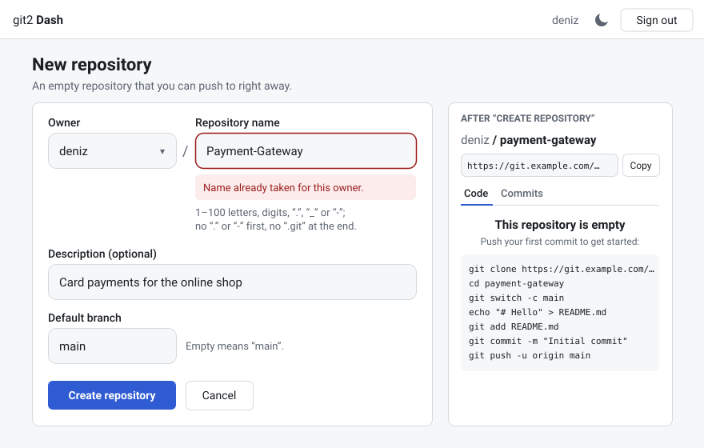

UT-01 opens it from the repository list (US-11, UC-10). **Owner** offers the user and the organizations where they have Maintain. **Repository name** shows the FR-25 rules and an in-place error, here for a taken name (UC-10 E1). **Default branch** is `main` when empty. **Create repository** leads to the empty repository page with the clone URL and first-push commands (right); **Cancel** returns to the list. Deleting is under Settings, Danger zone, after typing the name (FR-26).

### 4.x UI-G2 — Protected Branches

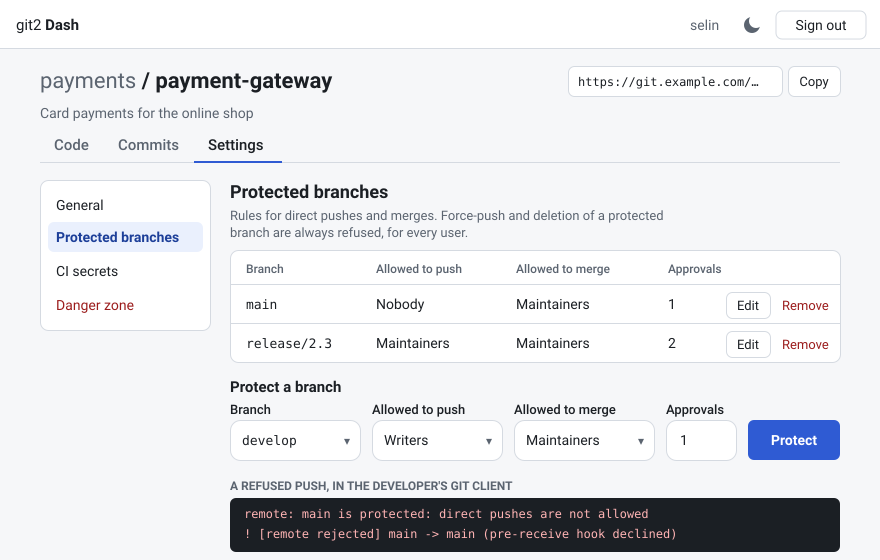

UT-02 opens it from a repository's **Settings** tab (US-16, UC-14); others get 403. The table lists each protected branch's push, merge and approval rules, with **Edit** and **Remove** (UC-14 A1); **Protect a branch** adds one. Force-push and deletion are always refused (FR-35). The dark box shows a refused push in the developer's `git` client; unmet merge rules appear in the merge request's merge box (FR-36).

---

## 5. Flow Diagrams

### 5.1 General Data Model

[Insert an entity–relationship diagram for the data stored in the project database.]

[Explain each entity and its purpose, significant attributes, primary and foreign keys, and each relationship’s cardinality and optionality. Describe any business rules that affect these relationships.]

<!-- Git core -->
**Git core entities (schema `git_svc`).**

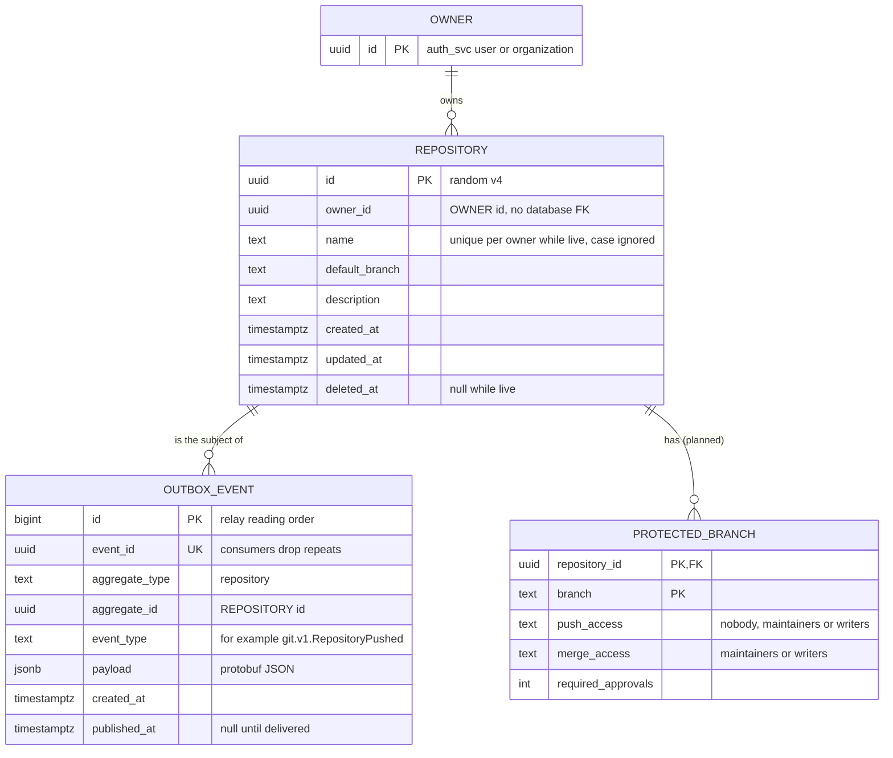

- **REPOSITORY:** one row per repository; its Git data stays on disk. `owner_id` points to an `auth_svc` user or organization without a database FK, since each service reads only its own schema (NFR-31). Deleted rows keep `deleted_at`; names are unique per owner among live rows, ignoring case (FR-25, FR-26).
- **OUTBOX_EVENT:** zero or more per repository, written with the change (FR-04); `event_id` lets consumers drop repeats; `published_at` is set once delivered (NFR-20).
- **PROTECTED_BRANCH** *(planned, WBS-7.1)*: zero or more per repository, one per branch (FR-34).

### 5.2 Important Data Considerations

Describe any applicable data formats and exchange mechanisms. Examples include JSON or XML payloads and asynchronous requests using Ajax.

| Interface or data exchange | Format or mechanism | Reason for choice | Validation or compatibility constraints |
|---|---|---|---|
| [Where data is exchanged or imported/exported] | [Format and/or mechanism] | [Why it fits this exchange] | [Schema, encoding, or relevant rules] |
| Git clients ↔ git-svc, via the gateway | Git smart HTTP (packfiles over HTTPS, protocol v2); LFS batch API in JSON *(planned)* | Unmodified `git` and `git-lfs` work (NFR-27) | Smart protocol only; push ≤ 2 GiB; LFS size and hash checked |
| Services → git-svc | gRPC with protobuf `git.v1`; streams for files, archives and bundles | Typed, versioned contract (NFR-28) | Additive changes; releases pinned in `contracts/git/` |
| git-svc → event subscribers | Outbox row, then `EventSink.Deliver`; protobuf JSON | Stored with the change (FR-04); at least once (NFR-20) | Consumers drop repeats by `event_id` |
| git-svc ↔ backup-svc | One Git bundle per repository | Git's own format; a restore re-checks objects | An empty repository is zero bytes |

[Explain how each choice affects the systems or components using it. If no special data considerations apply, briefly explain why.]

<!-- Git core -->
**Git core data exchange.** Git's own protocols need no client software, so git-svc enforces its own limits; other services reach repositories only through `git.v1`; event consumers must be idempotent.

### 5.3 Data Flow Diagrams

Provide diagrams for **Levels 0, 1, and 2**. Explain all external entities, processes, data stores, and named data flows shown at each level. Use consistent names and check that the inputs and outputs of each decomposed process match its parent diagram.

#### 5.3.1 Level 0

[Insert the context diagram. Show the system as a single process and explain the data it exchanges with each external entity.]

#### 5.3.2 Level 1

[Insert the Level 1 diagram. Explain the system’s main processes, the data stores they use, and how data moves among processes, stores, and external entities.]

#### 5.3.3 Level 2

[Insert a Level 2 diagram for a Level 1 process. Identify the parent process, explain each subprocess and its data flows, and show how the parent’s inputs and outputs are accounted for. Repeat for additional processes where more detail is needed.]

<!-- Git core -->
**Level 2 of process G — Host Git repositories (Git core).**

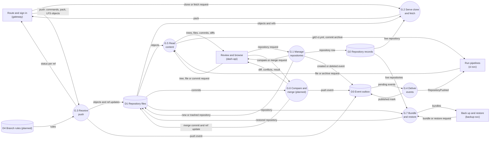

Parent: Level 1 process G (the editor numbers it). External processes: gateway (Git clients), dash-api, ci-svc, backup-svc. Stores: D1 repository files on disk, D2 `git_svc.repositories`, D3 `git_svc.outbox`, D4 branch rules (planned).

| Subprocess | Does | Stores |
|---|---|---|
| G.1 | Creates, lists, deletes repositories (UC-10) | D1, D2, D3 |
| G.2 | Serves clone and fetch (UC-11) | D1, D2 |
| G.3 | Checks rules, stores the push, writes its event (UC-11, UC-14, UC-15) | D1, D3, D4 |
| G.4 | Delivers events to subscribers (FR-04) | D3 |
| G.5 | Reads trees, files, commits, archives (UC-12, UC-21) | D1 |
| G.6 | Compares, merges, writes the push event (UC-18) | D1, D3 |
| G.7 | Bundles and restores repositories (UC-25, UC-26) | D1, D2 |

Every Level 1 flow of G appears here: requests and packs with the gateway; repository, content and merge calls with dash-api; events, files and archives with ci-svc; bundles with backup-svc.
